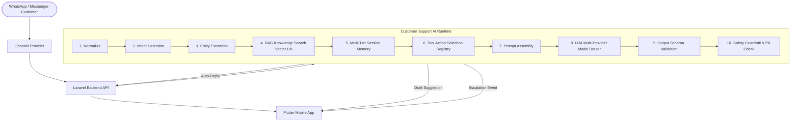

# Customer Support AI Runtime Architecture (Enterprise Specification)

## Overview
This directory contains the complete technical specification for the **Customer Support AI Runtime** — an enterprise multi-agent & RAG platform engineered for inbox automation, co-pilot drafting, intent triage, and ticket management across WhatsApp and Messenger channels.

The AI Runtime interfaces with the Laravel Backend (`https://backendapp.weoryx.com/api`) and the Flutter mobile application (`chat_app`).

```text
ai/
├── MANIFEST.json                  ← Machine-readable architecture index
├── README.md                      ← This master architecture specification
├── ARCHITECTURE_DECISIONS.md      ← ADR Index (ADR-001 to ADR-005)
├── DOCUMENTATION_GUIDELINES.md   ← Standards, 14-section template & rules
│
├── ADRs/                          ← Architecture Decision Records
│   ├── ADR-001_session_memory.md
│   ├── ADR-002_hybrid_ai_model.md
│   ├── ADR-003_laravel_proxy.md
│   ├── ADR-004_multi_provider_routing.md
│   └── ADR-005_decoupled_flutter_client.md
│
├── agents/                        ← Autonomous agent roles (Coordinator, Planner, etc.)
├── brain/                         ← Cognitive logic & 10-stage reasoning pipeline
│   └── reasoning_pipeline.md      ← 10-stage execution pipeline specification
│
├── config/                        ← Model routing, providers, token limits & costs
├── domains/                       ← Support domain business logic
├── knowledge/                     ← Reference knowledge base (Products, Policies, FAQs)
├── memory/                        ← Multi-tier memory (Working Memory, Summaries, CRM Facts)
├── observability/                 ← Metrics, token costs, CSAT & hallucination tracking
│   └── metrics.md
│
├── prompts/                       ← Agent prompts & reply templates
│   └── reply_templates/
│
├── rag/                           ← Retrieval-Augmented Generation Layer
│   ├── chunking.md
│   ├── embeddings.md
│   ├── indexing.md
│   ├── ranking.md
│   ├── retrieval.md
│   └── vector_store.md
│
├── schemas/                       ← JSON Schema Draft 2020-12 data contracts
├── sdk/                           ← OpenAPI 3.1 REST API specification
│   └── ai_runtime_api.md
├── shared/                        ← Constants, error codes, glossary, conventions
├── skills/                        ← AI capabilities (Drafting, Auto-reply, Summaries)
└── tools/                         ← Tool Registry & Action execution specs
    ├── registry.md
    └── actions/
```

---

## System Architecture Diagram



---

## Core Enterprise Modules

| Layer | Purpose | Key Files |
| :--- | :--- | :--- |
| **ADRs** | Architecture Decision Records | [ADRs/ADR-001_session_memory.md](ADRs/ADR-001_session_memory.md) |
| **Brain** | 10-Stage Reasoning & Decision Engine | [brain/reasoning_pipeline.md](brain/reasoning_pipeline.md) |
| **RAG** | Dense Vector & Hybrid Knowledge Search | [rag/retrieval.md](rag/retrieval.md), [rag/vector_store.md](rag/vector_store.md) |
| **Tools** | Machine-Readable Registry & Actions | [tools/registry.md](tools/registry.md), [tools/actions/assign_agent.md](tools/actions/assign_agent.md) |
| **SDK** | OpenAPI 3.1 REST Specification | [sdk/ai_runtime_api.md](sdk/ai_runtime_api.md) |
| **Config** | Multi-Provider & Cost Controls | [config/providers.md](config/providers.md), [config/cost_control.md](config/cost_control.md) |
| **Metrics**| OpenTelemetry & Cost Tracking | [observability/metrics.md](observability/metrics.md) |

---

## Related Specifications
- [MANIFEST.json](MANIFEST.json)
- [ARCHITECTURE_DECISIONS.md](ARCHITECTURE_DECISIONS.md)
- [DOCUMENTATION_GUIDELINES.md](DOCUMENTATION_GUIDELINES.md)
- [sdk/ai_runtime_api.md](sdk/ai_runtime_api.md)
