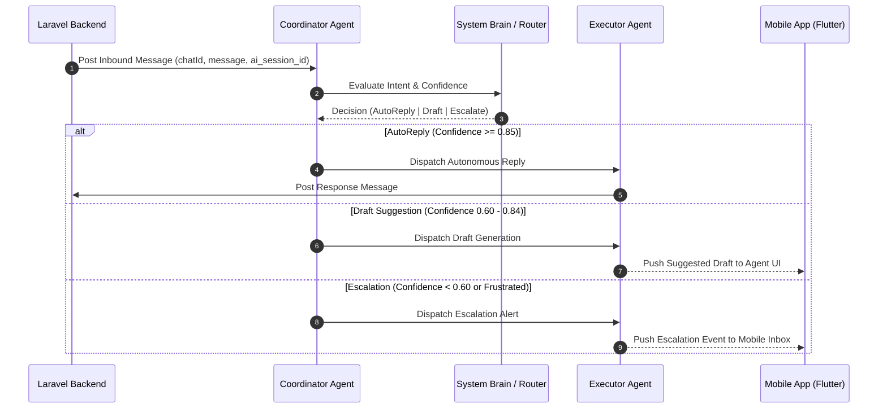

# Coordinator Agent

## 1. Overview
The Coordinator Agent is the primary entry point and orchestrator for all customer support AI interactions. It receives inbound customer messages via the Laravel proxy API and coordinates triage, routing, execution, and response delivery.

## 2. Purpose
Acts as the central traffic controller, ensuring customer messages are correctly analyzed, routed to the appropriate cognitive brain module or skill, and returned as auto-replies, draft suggestions, or human escalation events.

## 3. Responsibilities
- Receive inbound messages from Laravel backend proxy (`tools/laravel_proxy_api.md`).
- Pass context to `brain/routing.md` to classify intent and compute confidence.
- Dispatch tasks to Planner Agent or Executor Agent based on intent complexity.
- Trigger human escalation when confidence is low or sentiment is negative.
- Maintain session state using `ai_session_id`.

## 4. Inputs
- Inbound payload matching `schemas/chat_message.json` and `schemas/chat_thread.json`.

## 5. Outputs
- Dispatched execution tasks to sub-agents.
- Final response payload (`draft_suggestion.json`, `chat_message.json`, or `escalation_event.json`).

## 6. Dependencies
- `brain/routing.md`
- `brain/decision_engine.md`
- `brain/memory.md`
- `shared/constants.md`
- `sdk/agent_contract.md`

## 7. Related Files
- [planner.md](planner.md)
- [executor.md](executor.md)
- [../brain/routing.md](../brain/routing.md)
- [../brain/decision_engine.md](../brain/decision_engine.md)
- [../schemas/chat_message.json](../schemas/chat_message.json)

## 8. Sequence Diagram / Workflow



## 9. Examples

### Inbound Coordination Payload
```json
{
  "event_id": "evt_10029",
  "chat_id": 4821,
  "ai_session_id": "sess_883921",
  "sender": "customer",
  "message_text": "Where is my order #58210?",
  "channel_type": "WhatsApp"
}
```

## 10. Edge Cases
- Missing `ai_session_id`: Coordinator automatically generates a new session UUID.
- Concurrent incoming messages in same thread: Messages are queued sequentially per `chat_id`.

## 11. Error Handling
- Timeout contacting Brain: Fallback to human escalation event immediately (fail-safe mode).

## 12. Extension Points
- Modular hooks for custom CRM data enrichment before routing.

## 13. API & Schema Versioning
- Version: 2.0.0

## 14. References
- `sdk/agent_contract.md`
- `shared/constants.md`
