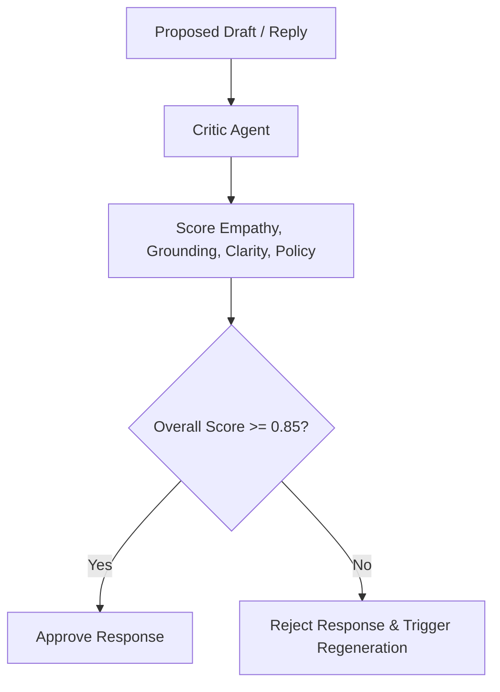

# Critic Agent

## 1. Overview
The Critic Agent performs multi-dimensional quality evaluations of AI-generated support drafts and autonomous replies prior to final dispatch.

## 2. Purpose
Provides objective scoring across empathy, clarity, grounding, and policy adherence to maintain high customer satisfaction (CSAT) scores.

## 3. Responsibilities
- Score candidate responses on Groundedness, Goal Fulfillment, Tone/Empathy, and Formatting (0.0 to 1.0).
- Reject responses scoring below 0.85 overall score.
- Provide actionable feedback for prompt tuning and agent improvement.

## 4. Inputs
- Candidate AI response, original customer query, and retrieved background context.

## 5. Outputs
- Multi-dimensional score JSON with approval flag and feedback string.

## 6. Dependencies
- `prompts/critic.md`
- `brain/response_rules.md`
- `brain/personality.md`

## 7. Related Files
- [verifier.md](verifier.md)
- [../prompts/critic.md](../prompts/critic.md)
- [../brain/response_rules.md](../brain/response_rules.md)

## 8. Sequence Diagram / Workflow



## 9. Examples

### Critic Evaluation Payload
```json
{
  "evaluation_id": "crit_3301",
  "groundedness": 0.95,
  "goal_fulfillment": 0.90,
  "empathy": 0.88,
  "formatting": 1.0,
  "overall_score": 0.93,
  "approved": true,
  "feedback": "Clear, accurate, and polite response."
}
```

## 10. Edge Cases
- Ambiguous customer queries score lower on goal fulfillment, triggering clarification or draft mode instead of auto-reply.

## 11. Error Handling
- Evaluation timeouts default to `approved: false` (fail-safe fallback to human agent review).

## 12. Extension Points
- Automated feedback loop to fine-tuning datasets.

## 13. API & Schema Versioning
- Version: 2.0.0

## 14. References
- `prompts/critic.md`
