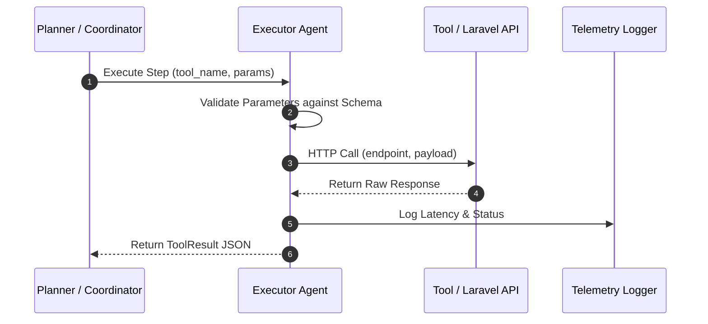

# Executor Agent

## 1. Overview
The Executor Agent is responsible for executing individual steps in an Execution Plan. It invokes backend tools, skill modules, and Laravel proxy endpoints, enforcing strict parameter validation and error capture.

## 2. Purpose
Safely executes tool calls and formats execution results for downstream consumption by Verifier and Summarizer agents.

## 3. Responsibilities
- Execute individual plan steps assigned by Coordinator or Planner.
- Validate inputs against tool schemas before calling APIs (`tools/`).
- Measure execution duration and record metrics.
- Return standardized outputs (`schemas/tool_result.json`).

## 4. Inputs
- Step definition from execution plan and resolved parameter context.

## 5. Outputs
- `schemas/tool_result.json` or `schemas/api_error.json`.

## 6. Dependencies
- `tools/laravel_proxy_api.md`
- `tools/chat_messages_api.md`
- `tools/send_message_api.md`
- `schemas/tool_call.json`
- `schemas/tool_result.json`

## 7. Related Files
- [coordinator.md](coordinator.md)
- [planner.md](planner.md)
- [../tools/laravel_proxy_api.md](../tools/laravel_proxy_api.md)
- [../schemas/tool_result.json](../schemas/tool_result.json)

## 8. Sequence Diagram / Workflow



## 9. Examples

### Execution Output
```json
{
  "call_id": "call_7721",
  "tool_name": "send_message_api",
  "status": "success",
  "data": {
    "message_id": 99104,
    "chat_id": 4821,
    "status": "sent"
  },
  "duration_ms": 145,
  "completed_at": "2026-08-04T12:00:00Z"
}
```

## 10. Edge Cases
- Backend API rate limits: Retries with backoff defined in `shared/constants.md`.

## 11. Error Handling
- Captures HTTP failures and emits structured `api_error.json` instances.

## 12. Extension Points
- Pre-execution mock driver for unit testing.

## 13. API & Schema Versioning
- Version: 2.0.0

## 14. References
- `sdk/tool_contract.md`
