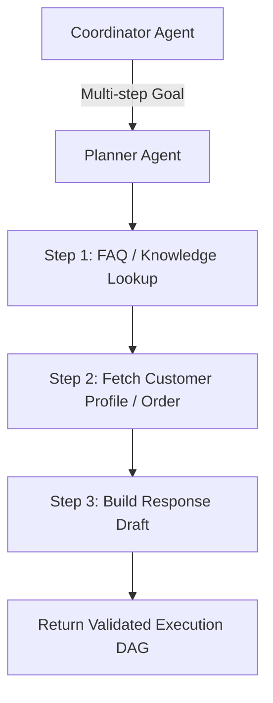

# Planner Agent

## 1. Overview
The Planner Agent breaks complex customer support requests into a structured, step-by-step Execution Plan (DAG) involving knowledge base lookups, CRM data fetches, intent validation, and response drafting.

## 2. Purpose
Provides explicit execution planning when a multi-step resolution is required before generating a customer response.

## 3. Responsibilities
- Receive multi-step goals from Coordinator Agent.
- Generate a validated JSON execution plan following `execution/plan.md`.
- Map inputs/outputs between dependent skill execution steps.

## 4. Inputs
- User goal and chat thread history.
- Available skills registry (`skills/support/`, `skills/general/`).

## 5. Outputs
- Structured execution plan JSON DAG.

## 6. Dependencies
- `execution/plan.md`
- `prompts/planner.md`
- `sdk/agent_contract.md`

## 7. Related Files
- [coordinator.md](coordinator.md)
- [executor.md](executor.md)
- [../execution/plan.md](../execution/plan.md)
- [../prompts/planner.md](../prompts/planner.md)

## 8. Sequence Diagram / Workflow



## 9. Examples

### Generated Execution Plan
```json
{
  "plan_id": "plan_9912",
  "chat_id": 4821,
  "steps": [
    {
      "step_id": 1,
      "skill": "support/classify_intent",
      "tool": "laravel_proxy_api",
      "input": { "text": "Where is my order #58210?" },
      "dependencies": []
    },
    {
      "step_id": 2,
      "skill": "support/draft_reply",
      "tool": "crm_customer_api",
      "input": { "order_id": "$step[1].output.order_id" },
      "dependencies": [1]
    }
  ]
}
```

## 10. Edge Cases
- Single-step requests (e.g. basic greetings) bypass Planner and run directly via Executor.

## 11. Error Handling
- Invalid DAG generation triggers re-planning up to 2 retries, then escalates to human agent.

## 12. Extension Points
- Dynamic step insertion based on customer VIP tier.

## 13. API & Schema Versioning
- Version: 2.0.0

## 14. References
- `execution/plan.md`
