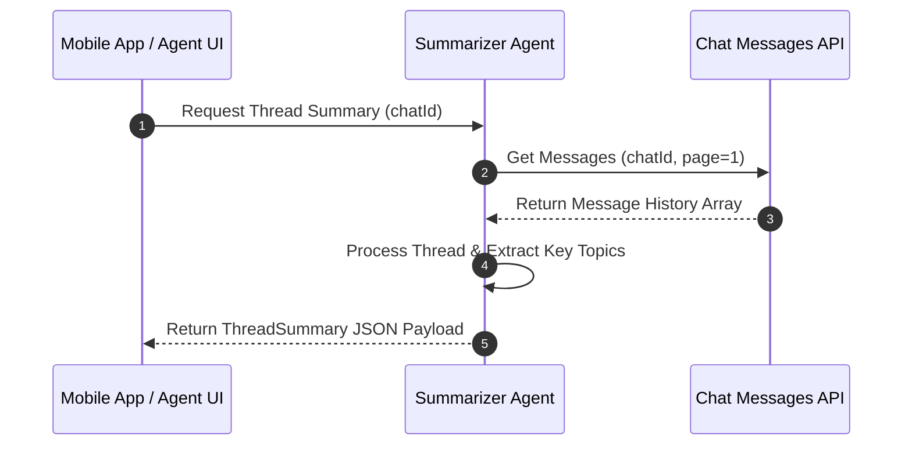

# Summarizer Agent

## 1. Overview
The Summarizer Agent processes long customer support message threads and generates concise, structured conversation summaries for human agents during handovers, ticket reviews, or shift changes.

## 2. Purpose
Saves support agents time by distilling lengthy customer interactions into key intent, issue history, attempted solutions, and current action items.

## 3. Responsibilities
- Read message arrays matching `schemas/chat_message.json`.
- Extract customer intent, main pain points, and current resolution status.
- Output structured summary payloads matching `schemas/thread_summary.json`.

## 4. Inputs
- Array of `MessageEntity` objects from `tools/chat_messages_api.md`.

## 5. Outputs
- `schemas/thread_summary.json` containing executive summary, key facts, and recommended next steps.

## 6. Dependencies
- `prompts/summarize_prompt.md`
- `schemas/thread_summary.json`
- `shared/constants.md`

## 7. Related Files
- [coordinator.md](coordinator.md)
- [../prompts/summarize_prompt.md](../prompts/summarize_prompt.md)
- [../schemas/thread_summary.json](../schemas/thread_summary.json)
- [../skills/support/summarize_thread.md](../skills/support/summarize_thread.md)

## 8. Sequence Diagram / Workflow



## 9. Examples

### Thread Summary Output
```json
{
  "summary_id": "sum_9012",
  "chat_id": 4821,
  "customer_name": "Ahmed Al-Rashid",
  "topic": "Order Delay #58210",
  "sentiment": "neutral",
  "key_points": [
    "Customer inquired about order #58210 placed on Aug 1.",
    "Package delayed at local distribution center.",
    "Customer requested expedited delivery."
  ],
  "recommended_action": "Contact logistics partner and issue tracking update."
}
```

## 10. Edge Cases
- Threads with < 3 messages: Generates a brief 1-sentence summary instead of full bulleted output.

## 11. Error Handling
- Message fetch errors return `API_TIMEOUT_EXCEEDED` and display partial summary if cached context exists.

## 12. Extension Points
- Customizable summary templates for different support tiers (VIP vs Standard).

## 13. API & Schema Versioning
- Version: 2.0.0

## 14. References
- `prompts/summarize_prompt.md`
