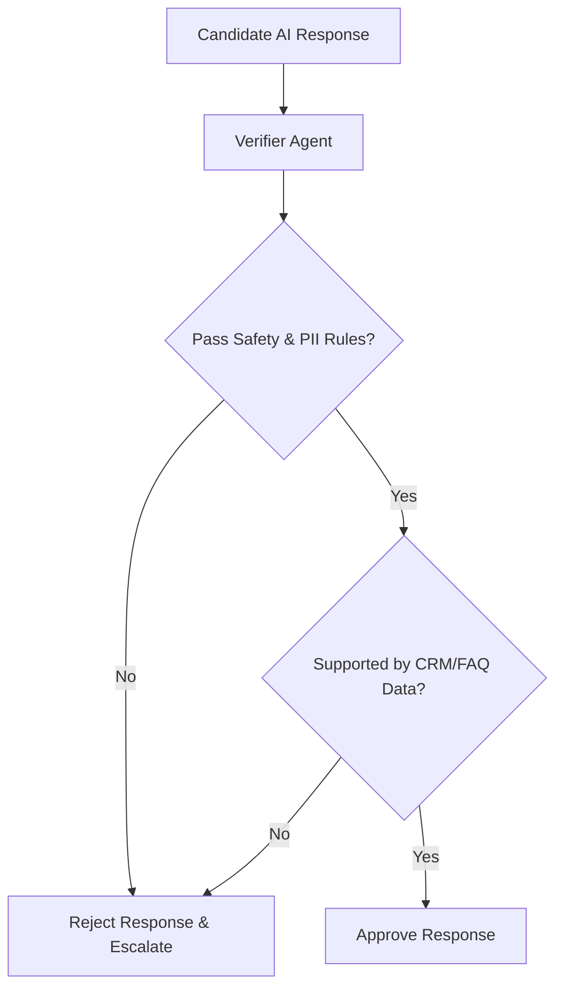

# Verifier Agent

## 1. Overview
The Verifier Agent verifies candidate responses, draft suggestions, and auto-replies against compliance, company policies, PII rules, and safety guardrails prior to sending or presenting to human support agents.

## 2. Purpose
Acts as a quality control filter preventing harmful, inaccurate, off-policy, or unverified AI output from reaching customers or agents.

## 3. Responsibilities
- Evaluate candidate text against `brain/safety.md` and `brain/response_rules.md`.
- Verify factual alignment between AI response and retrieved CRM / FAQ data.
- Ensure proper currency formatting, company tone, and politeness rules.

## 4. Inputs
- Candidate response text and ground-truth tool data.

## 5. Outputs
- Verification decision (`approved: true|false`, confidence adjustments, policy warnings).

## 6. Dependencies
- `brain/safety.md`
- `brain/response_rules.md`
- `brain/confidence.md`

## 7. Related Files
- [critic.md](critic.md)
- [summarizer.md](summarizer.md)
- [../brain/safety.md](../brain/safety.md)
- [../brain/response_rules.md](../brain/response_rules.md)

## 8. Sequence Diagram / Workflow



## 9. Examples

### Verification Result
```json
{
  "verification_id": "ver_4412",
  "approved": true,
  "safety_score": 1.0,
  "grounding_score": 0.96,
  "policy_violations": []
}
```

## 10. Edge Cases
- PII detected in draft (e.g. credit card number): Verifier redacts text and logs a safety warning.

## 11. Error Handling
- Rejection automatically routes message to `brain/recovery.md` for human escalation.

## 12. Extension Points
- Dynamic regulatory compliance checks per region (e.g. GDPR, CCPA).

## 13. API & Schema Versioning
- Version: 2.0.0

## 14. References
- `brain/safety.md`
