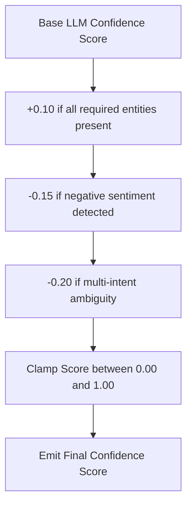

# Confidence Scoring Engine

## 1. Overview
The Confidence Scoring Engine calculates numerical confidence scores (0.00 to 1.00) for intent classifications, entity extractions, and candidate responses.

## 2. Purpose
Provides a quantitative metric used by the Decision Engine to determine whether to auto-reply, suggest a draft, or escalate.

## 3. Responsibilities
- Calculate composite confidence score based on LLM logprobs, entity clarity, and FAQ match distance.
- Apply penalty factors for missing parameters, negative sentiment, or multi-topic complexity.

## 4. Inputs
- Model raw confidence, entity extraction completeness, vector similarity score.

## 5. Outputs
- Floating point confidence score (0.00 to 1.00).

## 6. Dependencies
- `shared/constants.md`
- `brain/reasoning.md`

## 7. Related Files
- [decision_engine.md](decision_engine.md)
- [system_brain.md](system_brain.md)
- [../shared/constants.md](../shared/constants.md)

## 8. Sequence Diagram / Workflow

## 9. Examples

### Score Calculation Formula
$$\text{Score} = \text{Clamp}\left(\text{BaseScore} + \text{EntityBonus} - \text{SentimentPenalty} - \text{AmbiguityPenalty}, 0.0, 1.0\right)$$

- Base FAQ Match: 0.90
- All Entities Found: +0.05
- Negative Sentiment: -0.10
- **Final Confidence**: 0.85 (Triggers Auto-Reply)

## 10. Edge Cases
- Missing required entity (e.g. `order_id` missing in order status inquiry): Penalty forces score below 0.60, triggering clarification or human escalation.

## 11. Error Handling
- Null confidence calculation defaults to `0.00`.

## 12. Extension Points
- Fine-tuned scoring weights per support vertical.

## 13. API & Schema Versioning
- Version: 2.0.0

## 14. References
- `shared/constants.md`
