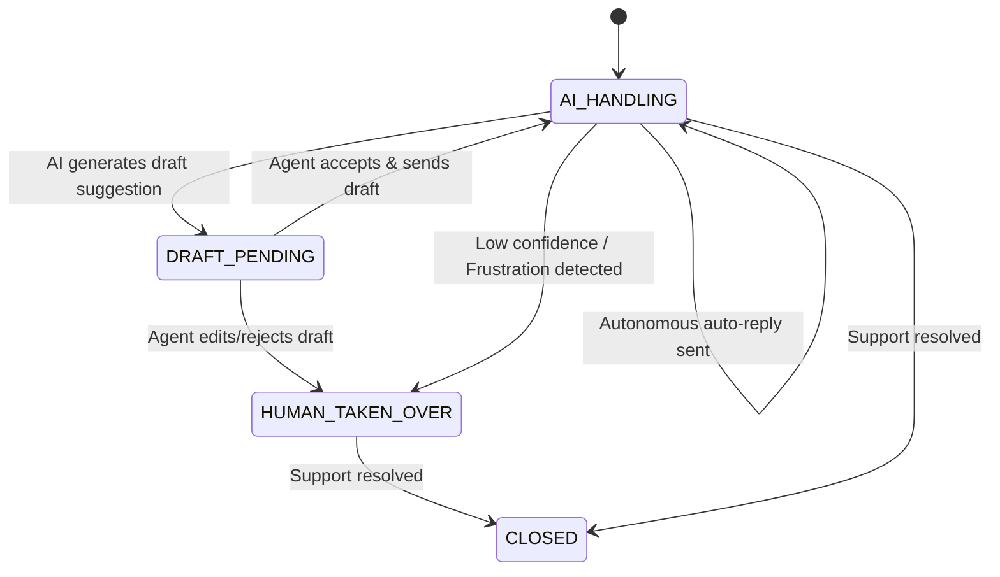

# Conversation Flow & State Machine

## 1. Overview
The Conversation Flow engine governs the lifecycle states of a customer support chat thread, managing transitions between AI handling, human agent review, and human agent takeover.

## 2. Purpose
Provides a deterministic state machine ensuring seamless hand-offs between AI auto-replies, draft suggestions, and human agents.

## 3. Responsibilities
- Track thread lifecycle state (`AI_HANDLING`, `DRAFT_PENDING`, `HUMAN_TAKEN_OVER`, `CLOSED`).
- Process state transition triggers.
- Enforce state-based message routing.

## 4. Inputs
- Thread events (`inbound_message`, `draft_accepted`, `draft_rejected`, `human_takeover_button`).

## 5. Outputs
- State transition notifications and UI state updates.

## 6. Dependencies
- `brain/decision_engine.md`
- `domains/chats/chats_domain.md`

## 7. Related Files
- [decision_engine.md](decision_engine.md)
- [system_brain.md](system_brain.md)
- [../domains/chats/chats_domain.md](../domains/chats/chats_domain.md)

## 8. Sequence Diagram / Workflow

## 9. Examples

### State Transition Matrix

| Current State | Event | Target State | Action |
| :--- | :--- | :--- | :--- |
| `AI_HANDLING` | Confidence >= 0.85 | `AI_HANDLING` | Send Auto-Reply |
| `AI_HANDLING` | Confidence 0.60–0.84 | `DRAFT_PENDING` | Push Draft to Agent UI |
| `AI_HANDLING` | Confidence < 0.60 | `HUMAN_TAKEN_OVER` | Send Escalation Alert |
| `DRAFT_PENDING` | Agent Sends Draft | `AI_HANDLING` | Send Message & Return to AI |
| `HUMAN_TAKEN_OVER` | Human Agent Active | `HUMAN_TAKEN_OVER` | AI Muted |

## 10. Edge Cases
- Human agent types manually while state is `DRAFT_PENDING`: Auto-transitions thread to `HUMAN_TAKEN_OVER`.

## 11. Error Handling
- Invalid state transitions raise `WORKFLOW_INVALID_STATE_TRANSITION` error.

## 12. Extension Points
- Automated re-engagement rules for inactive support threads.

## 13. API & Schema Versioning
- Version: 2.0.0

## 14. References
- `domains/chats/chats_domain.md`
