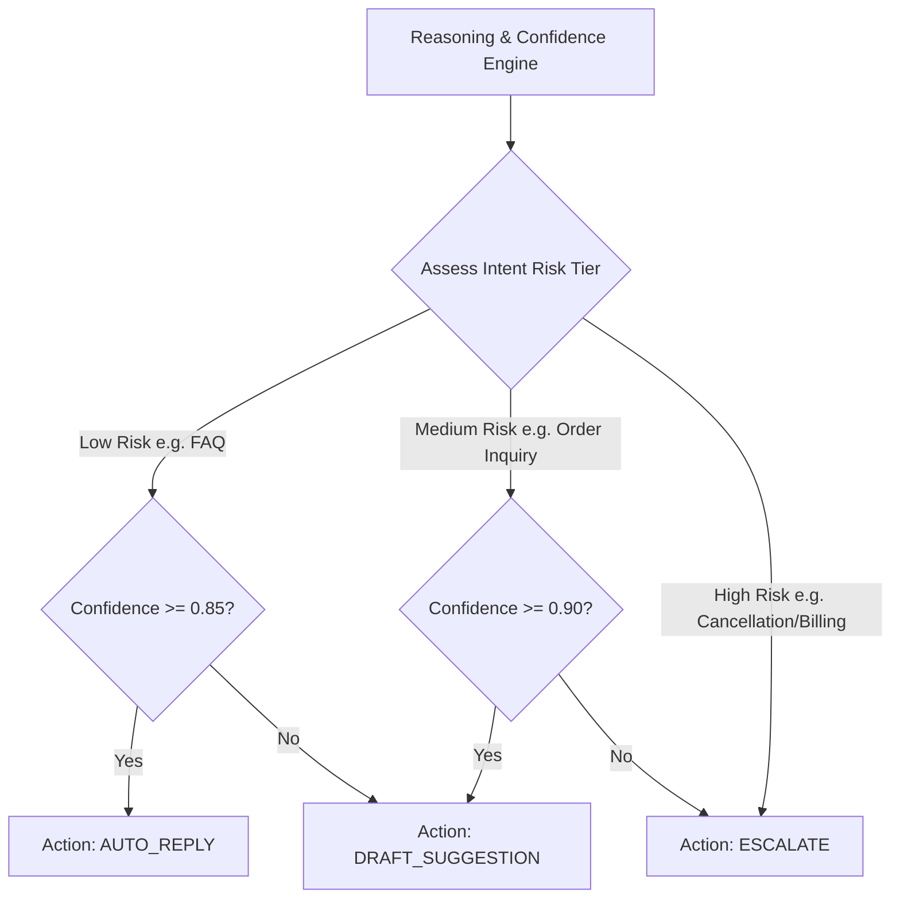

# Decision Engine — Hybrid Triage Matrix

## 1. Overview
The Decision Engine is the core triage processor that evaluates confidence scores, intent risk ratings, customer sentiment, and channel rules to select the final action: Auto-Reply, Draft Suggestion, or Human Escalation.

## 2. Purpose
Implements the hybrid model: auto-handling simple/standard queries while keeping human agents in control for complex, ambiguous, or sensitive requests.

## 3. Responsibilities
- Evaluate intent confidence (`confidence.md`).
- Assess intent risk tier (`Low`, `Medium`, `High`).
- Route to appropriate handling pipeline.

## 4. Inputs
- `intent_classification.json`, sentiment score, and confidence rating.

## 5. Outputs
- Operational decision enum: `AUTO_REPLY | DRAFT_SUGGESTION | ESCALATE`.

## 6. Dependencies
- `brain/confidence.md`
- `brain/reasoning.md`
- `shared/constants.md`

## 7. Related Files
- [confidence.md](confidence.md)
- [system_brain.md](system_brain.md)
- [../shared/constants.md](../shared/constants.md)

## 8. Sequence Diagram / Workflow

## 9. Examples

### Triage Rules Matrix

| Intent Category | Risk Level | Conf >= 0.85 | Conf 0.60 - 0.84 | Conf < 0.60 |
| :--- | :--- | :--- | :--- | :--- |
| `faq_hours` | Low | AUTO_REPLY | DRAFT_SUGGESTION | ESCALATE |
| `order_inquiry` | Medium | DRAFT_SUGGESTION | DRAFT_SUGGESTION | ESCALATE |
| `cancellation` | High | DRAFT_SUGGESTION | ESCALATE | ESCALATE |
| `billing_dispute` | High | ESCALATE | ESCALATE | ESCALATE |

## 10. Edge Cases
- Frustrated sentiment score (< -0.5): Automatically overrides risk level to High, forcing Escalation regardless of confidence score.

## 11. Error Handling
- Invalid evaluation context forces fallback to `ESCALATE`.

## 12. Extension Points
- Company-specific risk tier overrides via `config/features.md`.

## 13. API & Schema Versioning
- Version: 2.0.0

## 14. References
- `shared/constants.md`
