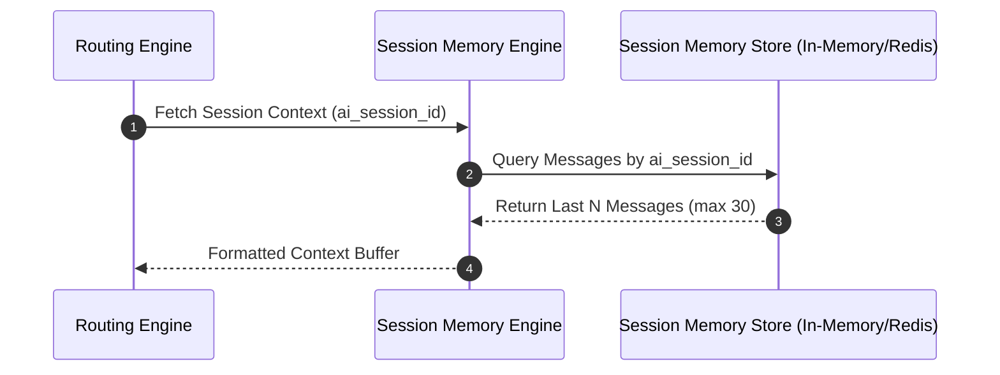

# Session Memory Architecture (`ai_session_id`)

## 1. Overview
The Session Memory architecture manages context storage and message history for active customer support threads. Memory is bound strictly to the `ai_session_id` lifecycle.

## 2. Purpose
Provides conversational context so the AI understands earlier turns within the active support session while preventing cross-session memory contamination.

## 3. Responsibilities
- Store and retrieve up to 30 recent turns per `ai_session_id`.
- Prune expired session memory upon chat completion, resolution, or human agent takeover.
- Expose working context buffer for system prompt injection.

## 4. Inputs
- `chatId`, `ai_session_id`, and `MessageEntity` payloads.

## 5. Outputs
- Memory context string formatted for system prompt context.

## 6. Dependencies
- `shared/constants.md`
- `schemas/chat_message.json`

## 7. Related Files
- [system_brain.md](system_brain.md)
- [conversation_flow.md](conversation_flow.md)
- [../shared/constants.md](../shared/constants.md)

## 8. Sequence Diagram / Workflow



## 9. Examples

### Session Context Window Configuration
```json
{
  "ai_session_id": "sess_883921",
  "chat_id": 4821,
  "max_history_turns": 30,
  "ttl_seconds": 86400,
  "status": "active"
}
```

## 10. Edge Cases
- Message limit overflow (> 30 messages): Summarizer Agent auto-condenses turns 1–20 into a brief context summary, keeping turns 21–30 verbatim.

## 11. Error Handling
- Memory lookup failure: System falls back to fetching current turn only from `tools/chat_messages_api.md`.

## 12. Extension Points
- Redis / In-Memory storage adapter bindings.

## 13. API & Schema Versioning
- Version: 2.0.0

## 14. References
- `shared/constants.md`
