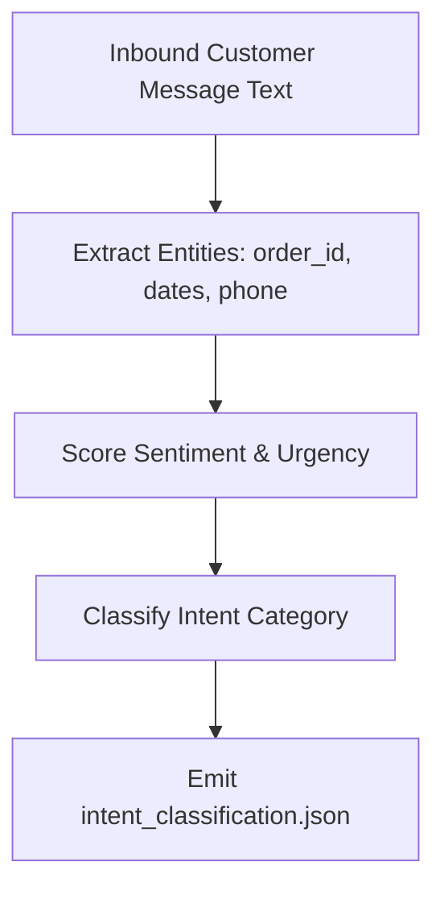

# Reasoning & Intent Analysis Module

## 1. Overview
The Reasoning module processes incoming customer text to extract intent, entities, sentiment, and urgency levels.

## 2. Purpose
Transforms unstructured customer messages into structured intent payloads used for routing and triage.

## 3. Responsibilities
- Classify customer intent into taxonomy categories (`order_inquiry`, `billing`, `complaint`, `faq`, `cancellation`).
- Extract key entities (`order_id`, `phone_number`, `date`, `product_id`).
- Evaluate sentiment score (-1.0 to +1.0) and urgency flag.

## 4. Inputs
- Message text from `schemas/chat_message.json`.

## 5. Outputs
- Intent classification payload (`schemas/intent_classification.json`).

## 6. Dependencies
- `schemas/intent_classification.json`
- `brain/routing.md`

## 7. Related Files
- [routing.md](routing.md)
- [decision_engine.md](decision_engine.md)
- [../schemas/intent_classification.json](../schemas/intent_classification.json)

## 8. Sequence Diagram / Workflow



## 9. Examples

### Extracted Reasoning Output
```json
{
  "intent": "order_inquiry",
  "confidence": 0.94,
  "sentiment_score": -0.2,
  "urgency": "medium",
  "entities": {
    "order_id": "58210"
  }
}
```

## 10. Edge Cases
- Multi-intent message (e.g. "Cancel my order and refund my money"): Reasoning identifies primary intent (`cancellation`) and secondary intent (`refund`).

## 11. Error Handling
- Low-confidence intent classification defaults to `general_inquiry` with reduced confidence score.

## 12. Extension Points
- Fine-tuned intent classifiers for vertical-specific support domains.

## 13. API & Schema Versioning
- Version: 2.0.0

## 14. References
- `schemas/intent_classification.json`
