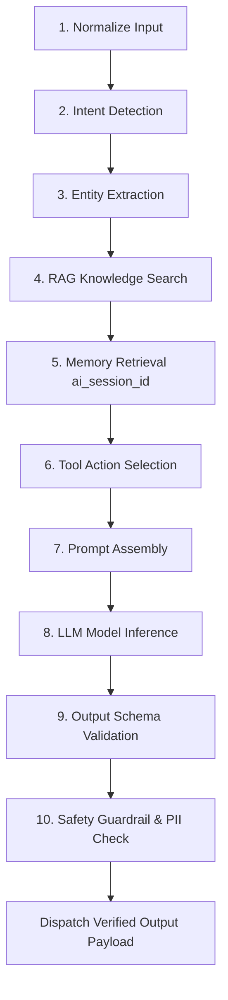

# 10-Stage Reasoning & Inference Pipeline (`reasoning_pipeline`)

## 1. Overview
Defines the explicit 10-stage sequential reasoning pipeline executed for every inbound customer support message before contacting the LLM and returning a response.

## 2. Purpose
Replaces direct LLM prompts with a structured, multi-stage processing pipeline ensuring deterministic safety, grounding, tool selection, and context retrieval.

## 3. Responsibilities
Execute the 10 processing stages sequentially:
1. **Normalize**: Clean input text, strip non-standard unicode, decode HTML.
2. **Intent Detection**: Classify intent category (`order_inquiry`, `cancellation`, `faq`).
3. **Entity Extraction**: Extract `order_id`, `phone_number`, `date`, `sku`.
4. **Knowledge Search (RAG)**: Query vector store for relevant FAQ & policy chunks.
5. **Memory Retrieval**: Load active session history (`working_memory.md`).
6. **Tool Selection**: Identify required tool actions (`tools/registry.md`).
7. **Prompt Builder**: Assemble system prompt, RAG context, and memory buffer.
8. **LLM Inference**: Dispatch request to selected model via provider router.
9. **Output Validation**: Validate response schema and formatting rules.
10. **Safety Check**: Perform PII redaction and sentiment guardrail verification.

## 4. Inputs
- Inbound customer message payload.

## 5. Outputs
- Approved response payload (`schemas/draft_suggestion.json` or `schemas/chat_message.json`).

## 6. Dependencies
- `brain/reasoning.md`
- `brain/routing.md`
- `rag/retrieval.md`
- `memory/working_memory.md`
- `tools/registry.md`
- `brain/safety.md`

## 7. Related Files
- [system_brain.md](system_brain.md)
- [decision_engine.md](decision_engine.md)
- [../rag/retrieval.md](../rag/retrieval.md)
- [../tools/registry.md](../tools/registry.md)

## 8. Sequence Diagram / Workflow



## 9. Examples

### Pipeline Execution Log
```json
{
  "trace_id": "tr_9901a2b",
  "chat_id": 4821,
  "stages_executed": 10,
  "rag_chunks_injected": 2,
  "tools_selected": ["crm_customer_api"],
  "llm_model": "claude-3-5-sonnet",
  "total_latency_ms": 780
}
```

## 10. Edge Cases
- Stage 4 RAG returns 0 matches: Pipeline proceeds with basic prompt assembly and sets confidence penalty.

## 11. Error Handling
- Failure at any stage halts pipeline and emits `schemas/api_error.json` with recovery fallback.

## 12. Extension Points
- Modular insertion of custom sentiment or compliance evaluation stages.

## 13. API & Schema Versioning
- Version: 2.0.0

## 14. References
- Enterprise Reasoning Pipeline Specifications.
