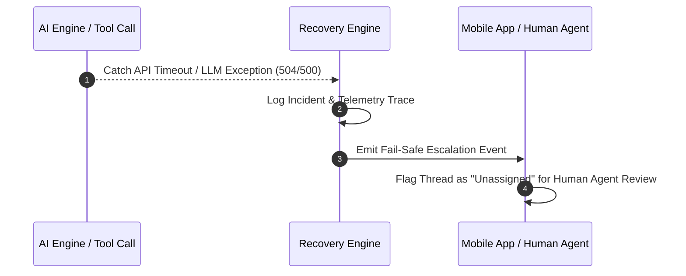

# Fallback & Error Recovery Architecture

## 1. Overview
The Fallback & Error Recovery module manages graceful degradation when AI inference fails, backend APIs time out, or unhandled exceptions occur.

## 2. Purpose
Ensures customer support availability is never disrupted by AI microservice outages or downstream API failures.

## 3. Responsibilities
- Intercept system errors and API timeouts (> 5000ms).
- Execute fallback strategies (fail-safe human escalation, static offline message).
- Reset corrupted session state (`ai_session_id`).

## 4. Inputs
- `schemas/api_error.json` instances.

## 5. Outputs
- Fallback escalation event or fallback message payload.

## 6. Dependencies
- `shared/error_codes.md`
- `shared/constants.md`

## 7. Related Files
- [system_brain.md](system_brain.md)
- [../shared/error_codes.md](../shared/error_codes.md)
- [../tools/laravel_proxy_api.md](../tools/laravel_proxy_api.md)

## 8. Sequence Diagram / Workflow

## 9. Examples

### Recovery Plan Matrix

| Failure Mode | Root Cause | Fallback Strategy | User Impact |
| :--- | :--- | :--- | :--- |
| `API_TIMEOUT_EXCEEDED` | Backend API down | Immediate human escalation | Message queued for agent |
| `LLM_RATE_LIMITED` | Inference capped | Failover to secondary LLM or escalation | Brief delay, zero dropped messages |
| `SCHEMA_VALIDATION_ERR` | Payload corrupt | Discard invalid output, trigger draft mode | Agent receives raw message |

## 10. Edge Cases
- Complete network blackout: Local mobile app fallback queues outgoing messages in `chats_local_data.dart`.

## 11. Error Handling
- All recovery actions logged with OpenTelemetry trace IDs.

## 12. Extension Points
- Circuit breaker integration for microservice health monitoring.

## 13. API & Schema Versioning
- Version: 2.0.0

## 14. References
- `shared/error_codes.md`
