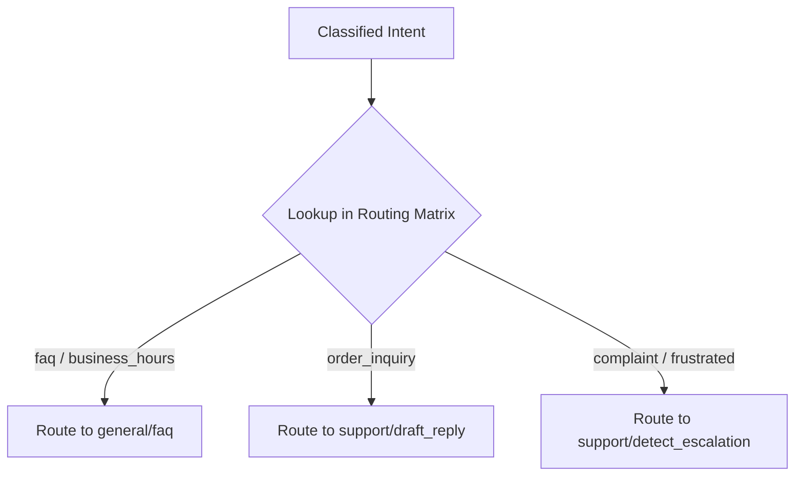

# Routing Engine & Intent Matrix

## 1. Overview
The Routing Engine maps classified intents to specific support skills and backend tool execution pathways.

## 2. Purpose
Ensures every customer query is routed to the exact skill handler best equipped to resolve it.

## 3. Responsibilities
- Maintain the Intent-to-Skill routing matrix.
- Select target skill(s) based on classified intent.
- Determine if multi-step execution planning is required.

## 4. Inputs
- `schemas/intent_classification.json` payload.

## 5. Outputs
- Routed target skill identifier (e.g. `support/draft_reply`, `support/autonomous_reply`, `general/faq`).

## 6. Dependencies
- `brain/reasoning.md`
- `skills/support/`
- `skills/general/`

## 7. Related Files
- [reasoning.md](reasoning.md)
- [decision_engine.md](decision_engine.md)
- [system_brain.md](system_brain.md)

## 8. Sequence Diagram / Workflow

## 9. Examples

### Intent-to-Skill Routing Matrix

| Intent Category | Target Skill | Handling Mode | Requires Planning |
| :--- | :--- | :--- | :--- |
| `faq_hours` | `general/faq` | Autonomous Reply | No |
| `faq_location` | `general/faq` | Autonomous Reply | No |
| `order_inquiry` | `support/draft_reply` | Draft Suggestion | Yes |
| `billing_dispute` | `support/detect_escalation` | Human Escalation | No |
| `complaint` | `support/detect_escalation` | Human Escalation | No |
| `cancellation` | `support/draft_reply` | Draft Suggestion | Yes |

## 10. Edge Cases
- Unmatched intent: Routes to `support/draft_reply` with standard agent review flag.

## 11. Error Handling
- Routing matrix lookup failure defaults to human agent escalation.

## 12. Extension Points
- Dynamic routing overrides based on company channel config (`ai/config/permissions.md`).

## 13. API & Schema Versioning
- Version: 2.0.0

## 14. References
- `skills/support/`
