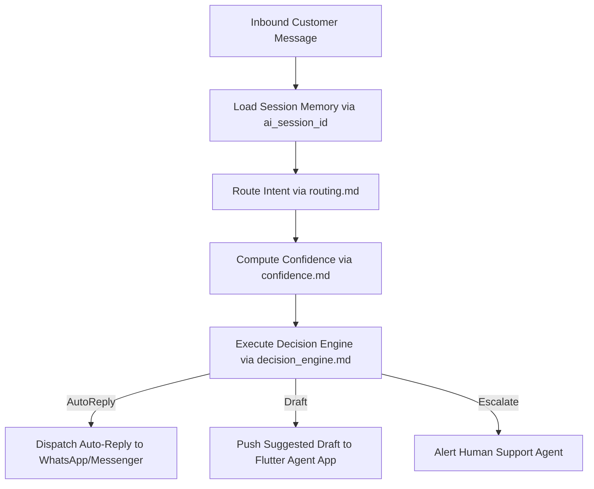

# System Brain — Master Cognitive Architecture

## 1. Overview
The System Brain is the core cognitive processor of the Customer Support AI Microservice. It manages system prompt injection, intent classification, memory retrieval, confidence evaluation, and decision engine execution.

## 2. Purpose
Provides centralized intelligence governing how customer messages are processed, understood, and answered across all channels.

## 3. Responsibilities
- Maintain master system prompt directives (`prompts/system.md`).
- Intersect intent classification from `routing.md` with confidence thresholds from `confidence.md`.
- Coordinate session memory retrieval (`memory.md`).
- Execute the triage state machine (`decision_engine.md`).

## 4. Inputs
- Inbound customer message text, channel context, and session history (`ai_session_id`).

## 5. Outputs
- Orchestrated execution action (Auto-Reply, Draft Suggestion, or Escalation Event).

## 6. Dependencies
- `brain/personality.md`
- `brain/routing.md`
- `brain/memory.md`
- `brain/decision_engine.md`
- `brain/confidence.md`
- `brain/safety.md`

## 7. Related Files
- [routing.md](routing.md)
- [decision_engine.md](decision_engine.md)
- [memory.md](memory.md)
- [safety.md](safety.md)
- [../prompts/system.md](../prompts/system.md)

## 8. Sequence Diagram / Workflow



## 9. Examples

### Cognitive Processing Trace
```json
{
  "chat_id": 4821,
  "ai_session_id": "sess_883921",
  "intent": "order_inquiry",
  "confidence": 0.92,
  "action": "AUTO_REPLY",
  "memory_messages_loaded": 4
}
```

## 10. Edge Cases
- Session memory corruption: Automatically initializes fresh session buffer without dropping request.

## 11. Error Handling
- Reasoning failures trigger fail-safe escalation to human support agent.

## 12. Extension Points
- Plug-and-play cognitive reasoning modules for new channels or specialized support teams.

## 13. API & Schema Versioning
- Version: 2.0.0

## 14. References
- `prompts/system.md`
