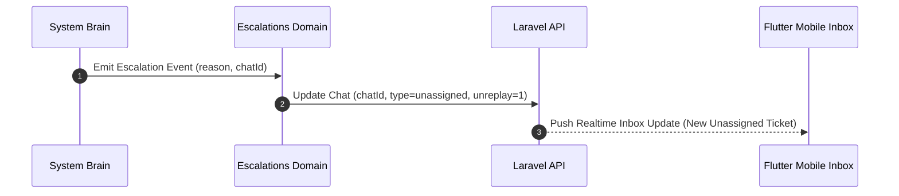

# Escalations Domain Business Logic Specification

## 1. Overview
The Escalations Domain governs human agent takeover rules, escalation triggers, priority assignment, and notification dispatch when AI steps down.

## 2. Purpose
Ensures smooth transition of support thread management from AI to human agents without losing conversation context.

## 3. Responsibilities
- Monitor escalation triggers (low confidence, negative sentiment, customer request).
- Reassign thread `type` to `unassigned` and set `unreplay` to `1` in Laravel API.
- Push push notification to human support agents via Firebase / WebSocket.

## 4. Inputs
- `schemas/escalation_event.json` payload.

## 5. Outputs
- Thread status update call to Laravel API.

## 6. Dependencies
- `schemas/escalation_event.json`
- `brain/confidence.md`
- `brain/safety.md`

## 7. Related Files
- [../chats/chats_domain.md](../chats/chats_domain.md)
- [../../schemas/escalation_event.json](../../schemas/escalation_event.json)
- [../../brain/confidence.md](../../brain/confidence.md)

## 8. Sequence Diagram / Workflow

## 9. Examples

### Escalation Trigger Criteria

| Trigger | Condition | Target Action |
| :--- | :--- | :--- |
| **Low Confidence** | Confidence < 0.60 | Reassign to Unassigned Queue |
| **Customer Frustration** | Sentiment < -0.50 | Priority Escalation |
| **Manual Agent Claim** | Agent taps "Take Over" | Mute AI, Assign to Agent |

## 10. Edge Cases
- All human agents offline: Escalation queues ticket with high priority tag and dispatches urgent push notification.

## 11. Error Handling
- Escalation failure raises `WORKFLOW_ESCALATION_FAILED` error and retries API call immediately.

## 12. Extension Points
- Skill-based routing to specific agent groups (e.g. Billing Team vs Tech Support).

## 13. API & Schema Versioning
- Version: 2.0.0

## 14. References
- `schemas/escalation_event.json`
