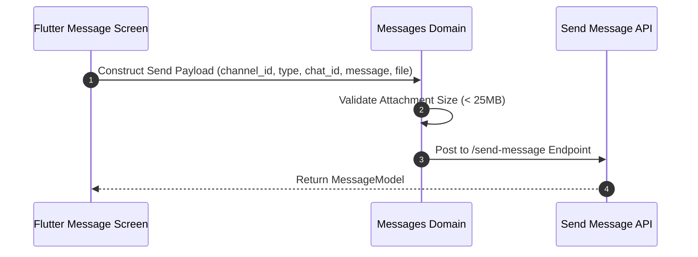

# Messages Domain Business Logic Specification

## 1. Overview
The Messages Domain governs individual message validation, payload normalization, media attachment handling, and message dispatch.

## 2. Purpose
Aligns AI message generation and reading with the Flutter `MessageEntity` data structure and `/chat-messages/{{chatId}}` backend endpoint.

## 3. Responsibilities
- Validate inbound/outbound message fields (`id`, `chat_id`, `sender`, `type`, `media_url`).
- Handle multi-part media uploads (images, audio notes, document attachments).
- Normalize raw backend response shapes to `MessageEntity` instances.

## 4. Inputs
- `MessageModel` and raw JSON objects from `/chat-messages/{{chatId}}`.

## 5. Outputs
- Validated `MessageEntity` objects matching `schemas/chat_message.json`.

## 6. Dependencies
- `schemas/chat_message.json`
- `tools/chat_messages_api.md`

## 7. Related Files
- [../chats/chats_domain.md](../chats/chats_domain.md)
- [../../schemas/chat_message.json](../../schemas/chat_message.json)
- [../../tools/send_message_api.md](../../tools/send_message_api.md)

## 8. Sequence Diagram / Workflow

## 9. Examples

### Message Type Rules Table

| Message Type (`type`) | Media Allowed | Max File Size | Required Fields |
| :--- | :--- | :--- | :--- |
| `text` | No | N/A | `text` |
| `image` | Yes | 25 MB | `media_url` or `file` |
| `audio` | Yes | 25 MB | `media_url`, max 60s duration |
| `document` | Yes | 25 MB | `media_url` or `file` |

## 10. Edge Cases
- Audio recordings exceeding 60 seconds: Automatically rejected with client validation error before sending.

## 11. Error Handling
- Attachment failure returns `TOOL_ATTACHMENT_TOO_LARGE` error.

## 12. Extension Points
- Voice-to-text transcription engine integration for audio messages.

## 13. API & Schema Versioning
- Version: 2.0.0

## 14. References
- Flutter model: `lib/features/home/data/models/message_model.dart`
