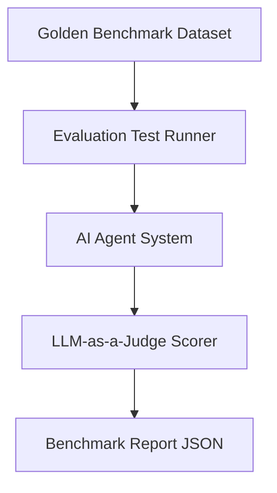

# Evaluation Benchmarks & Golden Test Sets

## 1. Overview
Defines benchmark datasets, golden response pairs, and performance baselines for evaluating AI agent intelligence.

## 2. Purpose
Prevents quality regressions during prompt tuning, model upgrades, or skill additions.

## 3. Responsibilities
- Maintain golden test cases covering single-turn Q&A, multi-turn travel planning, and edge cases.
- Measure intent routing accuracy (Target: > 98%).

## 4. Inputs
Evaluation query dataset.

## 5. Outputs
Benchmark score report (`Accuracy`, `Pass Rate`, `Latency`).

## 6. Dependencies
- [routing.md](file:///c:/Users/bss/studio%20projects/chat_app/ai/brain/routing.md)

## 7. Related Files
- [prompt_tests.md](file:///c:/Users/bss/studio%20projects/chat_app/ai/evaluation/prompt_tests.md)
- [quality_metrics.md](file:///c:/Users/bss/studio%20projects/chat_app/ai/evaluation/quality_metrics.md)

## 8. Sequence Diagram / Workflow


## 9. Examples
```json
{
  "test_case_id": "bench_012",
  "input": "Find hotels in Rome under €150 and check if it rains tomorrow.",
  "expected_intents": ["maps/location", "weather/weather", "travel/search_experiences"],
  "min_pass_score": 0.90
}
```

## 10. Edge Cases
Ambiguous queries evaluated against multiple acceptable gold standard answers.

## 11. Error Handling
Failed test cases output detailed diffs comparing expected vs actual execution DAGs.

## 12. Extension Points
Automate CI/CD benchmark runs on every GitHub PR.

## 13. API & Schema Versioning
Evaluation Spec: 1.0.0

## 14. References
- MMLU & HumanEval Benchmark Methodologies.
