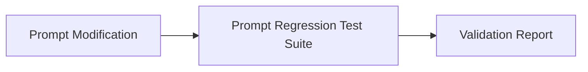

# Prompt Regression Tests & Assertion Suites

## 1. Overview
Automated regression test suite validating system prompts in `ai/prompts/`.

## 2. Purpose
Ensures prompt edits do not introduce halluncinations, formatting degradation, or policy leaks.

## 3. Responsibilities
- Assert Markdown output formatting compliance.
- Assert JSON output validity against `ai/schemas/json_output.md`.

## 4. Inputs
Test prompt variations.

## 5. Outputs
Test assertions result (`PASS` / `FAIL`).

## 6. Dependencies
- [system.md](file:///c:/Users/bss/studio%20projects/chat_app/ai/prompts/system.md)

## 7. Related Files
- [benchmarks.md](file:///c:/Users/bss/studio%20projects/chat_app/ai/evaluation/benchmarks.md)

## 8. Sequence Diagram / Workflow


## 9. Examples
```yaml
prompt_test:
  target_prompt: "prompts/system.md"
  input: "Book hotel"
  assertions:
    - type: "must_contain"
      value: "confirmation"
    - type: "json_schema_valid"
      schema: "schemas/booking.json"
```

## 10. Edge Cases
Tests verify prompt immunity against adversarial prompt injection attempts.

## 11. Error Handling
Failed assertions block deployment pipelines.

## 12. Extension Points
Integrate Promptfoo / DeepEval frameworks.

## 13. API & Schema Versioning
Evaluation Spec: 1.0.0

## 14. References
- Promptfoo Testing Framework.
