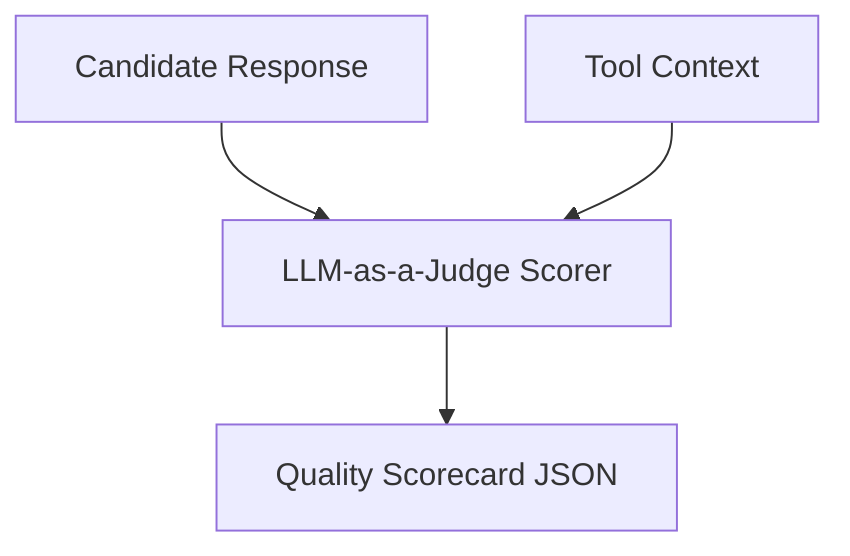

# Response Quality Metrics & LLM-as-a-Judge

## 1. Overview
Defines scoring criteria for evaluating response helpfulness, groundedness, conciseness, and tone using an LLM-as-a-Judge model.

## 2. Purpose
Provides continuous automated quality scoring (G-Eval methodology) for user responses.

## 3. Responsibilities
- Score groundedness (0.0 to 1.0): Are facts supported by tool output?
- Score conciseness (0.0 to 1.0): Is filler text minimized?
- Score formatting (0.0 to 1.0): Does output follow `response_rules.md`?

## 4. Inputs
Candidate response & source tool outputs.

## 5. Outputs
Multi-dimensional quality score card.

## 6. Dependencies
- [response_rules.md](file:///c:/Users/bss/studio%20projects/chat_app/ai/brain/response_rules.md)

## 7. Related Files
- [critic.md](file:///c:/Users/bss/studio%20projects/chat_app/ai/agents/critic.md)
- [benchmarks.md](file:///c:/Users/bss/studio%20projects/chat_app/ai/evaluation/benchmarks.md)

## 8. Sequence Diagram / Workflow


## 9. Examples
```json
{
  "groundedness": 0.98,
  "relevance": 0.95,
  "conciseness": 0.92,
  "formatting_compliance": 1.0,
  "overall_score": 0.96
}
```

## 10. Edge Cases
Scores below 0.80 trigger automatic review by the Critic Agent.

## 11. Error Handling
Judge model failures default to conservative fallback evaluation score.

## 12. Extension Points
Integrate Ragas evaluation library metrics.

## 13. API & Schema Versioning
Evaluation Spec: 1.0.0

## 14. References
- G-Eval: NLG Evaluation using GPT-4 with Better Human Alignment.
