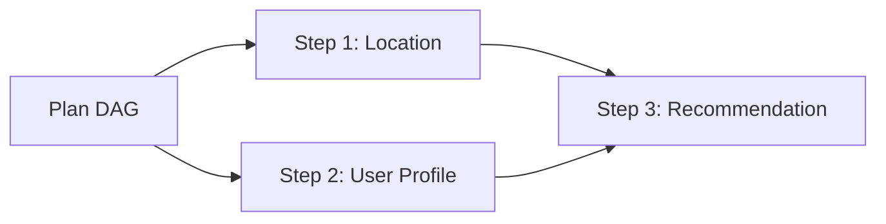

# Directed Acyclic Graph (DAG) Plan Representation

## 1. Overview
Defines the `Plan` object model representing compiled execution graphs created by the Planner Agent.

## 2. Purpose
Provides serializable, validated DAG structures for multi-step task execution.

## 3. Responsibilities
- Validate step dependencies to prevent cycles.
- Identify steps eligible for parallel execution.

## 4. Inputs
Planner Agent decomposition output.

## 5. Outputs
Validated Execution DAG.

## 6. Dependencies
- [planner.md](file:///c:/Users/bss/studio%20projects/chat_app/ai/agents/planner.md)

## 7. Related Files
- [task.md](file:///c:/Users/bss/studio%20projects/chat_app/ai/execution/task.md)
- [step.md](file:///c:/Users/bss/studio%20projects/chat_app/ai/execution/step.md)

## 8. Sequence Diagram / Workflow


## 9. Examples
```json
{
  "plan_id": "plan_99210",
  "task_id": "task_10928",
  "is_parallel_allowed": true,
  "steps_count": 3
}
```

## 10. Edge Cases
Cycles in step dependencies rejected during validation.

## 11. Error Handling
Invalid DAG returns `WORKFLOW_ERR_CYCLIC_DEPENDENCY`.

## 12. Extension Points
Visualize DAG in developer dashboard.

## 13. API & Schema Versioning
Execution Spec: 1.0.0

## 14. References
- DAG Algorithms & Topological Sorting.
