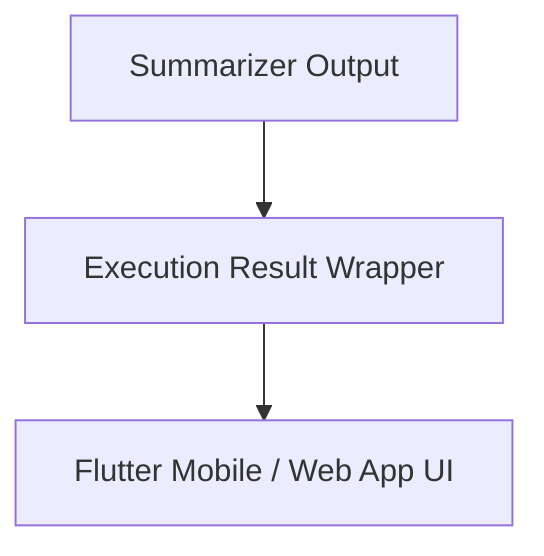

# Execution Result Wrapper & Payload Contract

## 1. Overview
Defines the `ExecutionResult` wrapper returned upon task completion.

## 2. Purpose
Encapsulates final user response text, artifacts, confidence metrics, and execution metadata.

## 3. Responsibilities
- Wrap Markdown response text.
- Include execution trace metrics (`duration_ms`, `tokens_used`).

## 4. Inputs
Summarizer Agent output.

## 5. Outputs
Final UI payload.

## 6. Dependencies
- [summarizer.md](file:///c:/Users/bss/studio%20projects/chat_app/ai/agents/summarizer.md)

## 7. Related Files
- [task.md](file:///c:/Users/bss/studio%20projects/chat_app/ai/execution/task.md)

## 8. Sequence Diagram / Workflow


## 9. Examples
```json
{
  "task_id": "task_10928",
  "status": "SUCCESS",
  "response_markdown": "# Weather in Paris\n...",
  "confidence": 0.98,
  "metrics": {"total_ms": 612}
}
```

## 10. Edge Cases
Partial results returned if task partially succeeded before non-critical error.

## 11. Error Handling
Failed tasks output `api_error.json` payload inside result wrapper.

## 12. Extension Points
Add Flutter UI widget rendering hints.

## 13. API & Schema Versioning
Execution Spec: 1.0.0

## 14. References
- [DOCUMENTATION_GUIDELINES.md](file:///c:/Users/bss/studio%20projects/chat_app/ai/DOCUMENTATION_GUIDELINES.md)
