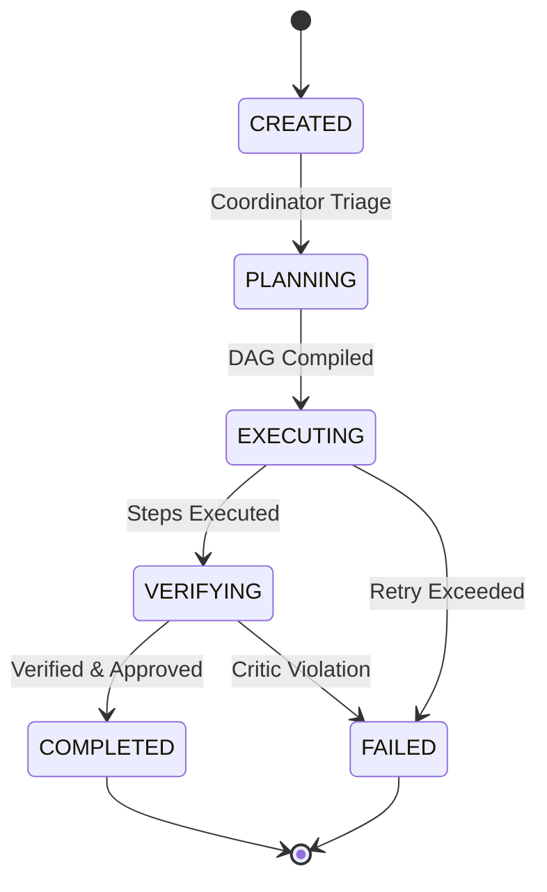

# Task Execution State & Lifecycle

## 1. Overview
Defines the `Task` object model representing top-level execution requests in the system.

## 2. Purpose
Tracks task status from initial intake by Coordinator Agent through completion or failure.

## 3. Responsibilities
- State graph management: `CREATED` -> `PLANNING` -> `EXECUTING` -> `VERIFYING` -> `COMPLETED` / `FAILED`.
- Store task metadata, session correlation, and time tracking.

## 4. Inputs
User session request.

## 5. Outputs
Task execution state object.

## 6. Dependencies
- [constants.md](file:///c:/Users/bss/studio%20projects/chat_app/ai/shared/constants.md)

## 7. Related Files
- [coordinator.md](file:///c:/Users/bss/studio%20projects/chat_app/ai/agents/coordinator.md)
- [plan.md](file:///c:/Users/bss/studio%20projects/chat_app/ai/execution/plan.md)
- [step.md](file:///c:/Users/bss/studio%20projects/chat_app/ai/execution/step.md)

## 8. Sequence Diagram / Workflow


## 9. Examples
```json
{
  "task_id": "task_10928",
  "session_id": "sess_883921",
  "status": "EXECUTING",
  "created_at": "2026-08-04T12:00:00Z",
  "current_step_id": 2,
  "total_steps": 3
}
```

## 10. Edge Cases
Tasks cancelled by user transition immediately to `CANCELLED` state.

## 11. Error Handling
Unhandled agent crashes transition task status to `FAILED` with error log snapshot.

## 12. Extension Points
Expose task state machine over WebSocket to Flutter UI.

## 13. API & Schema Versioning
Execution Spec: 1.0.0

## 14. References
- State Machine Workflow Patterns.
