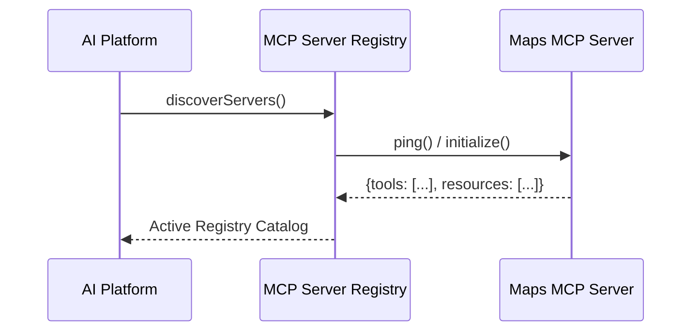

# MCP Server Registry & Capability Discovery

## 1. Overview
Central catalog of Model Context Protocol (MCP) servers connected to the AI platform.

## 2. Purpose
Enables dynamic discovery of external tools, resources, and prompt templates exposed by third-party MCP servers.

## 3. Responsibilities
- Catalog active MCP servers: `maps-mcp`, `weather-mcp`, `booking-mcp`, `firebase-mcp`.
- Perform health checks and capability negotiation upon server connect.

## 4. Inputs
Server configuration URIs and transport bindings.

## 5. Outputs
Unified tool & resource directory.

## 6. Dependencies
- [tool_contract.md](file:///c:/Users/bss/studio%20projects/chat_app/ai/sdk/tool_contract.md)

## 7. Related Files
- [transport.md](file:///c:/Users/bss/studio%20projects/chat_app/ai/mcp/transport.md)
- [tools.md](file:///c:/Users/bss/studio%20projects/chat_app/ai/mcp/tools.md)
- [security.md](file:///c:/Users/bss/studio%20projects/chat_app/ai/mcp/security.md)

## 8. Sequence Diagram / Workflow


## 9. Examples
```json
{
  "mcp_servers": [
    {
      "id": "maps_server",
      "transport": "stdio",
      "command": "npx -y @modelcontextprotocol/server-google-maps",
      "status": "HEALTHY"
    }
  ]
}
```

## 10. Edge Cases
Server disconnects trigger fallback to native REST API tool contracts.

## 11. Error Handling
Unreachable MCP servers are marked `DEGRADED` and removed from active routing.

## 12. Extension Points
Add custom Laravel or Firebase MCP server endpoints.

## 13. API & Schema Versioning
MCP Specification Version: 1.0.0

## 14. References
- Model Context Protocol (MCP) Specification.
