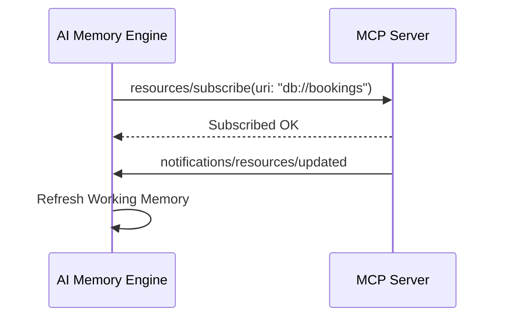

# MCP Resource Subscriptions & Context Attachment

## 1. Overview
Defines subscription mechanisms for external MCP resources (e.g. database change feeds, live weather updates, file system resources).

## 2. Purpose
Attaches real-time context data directly into `ai/memory/working_memory.md`.

## 3. Responsibilities
- Manage `resources/subscribe` and `resources/unsubscribe` subscriptions.
- Update working memory upon `notifications/resources/updated`.

## 4. Inputs
Resource URIs (e.g. `file:///logs/app.log` or `db://bookings/active`).

## 5. Outputs
Memory state updates.

## 6. Dependencies
- [working_memory.md](file:///c:/Users/bss/studio%20projects/chat_app/ai/memory/working_memory.md)

## 7. Related Files
- [registry.md](file:///c:/Users/bss/studio%20projects/chat_app/ai/mcp/registry.md)

## 8. Sequence Diagram / Workflow


## 9. Examples
```json
{
  "uri": "travel://events/live",
  "mimeType": "application/json",
  "name": "Live Local Events Stream"
}
```

## 10. Edge Cases
Stale resources trigger automatic resubscription.

## 11. Error Handling
Subscription drops log warnings and fall back to pull queries.

## 12. Extension Points
Add custom WebSocket resource feeds.

## 13. API & Schema Versioning
MCP Resource Spec: 1.0.0

## 14. References
- MCP Resource Protocol.
