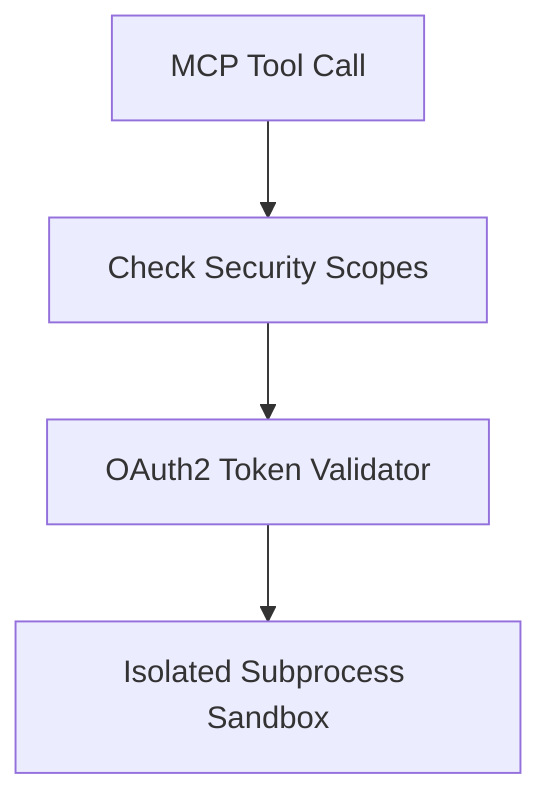

# MCP Security, Authentication & Sandboxing

## 1. Overview
Defines authentication policies, OAuth2 token passthrough, sandboxing rules, and scope limitations for MCP connections.

## 2. Purpose
Protects backend systems from malicious tool executions or unauthorized data access.

## 3. Responsibilities
- Validate API keys and OAuth2 bearer tokens.
- Restrict subprocess tool execution within OS-level sandboxes.

## 4. Inputs
Authentication headers & security scopes.

## 5. Outputs
Authorized / Rejected execution token.

## 6. Dependencies
- [permissions.md](file:///c:/Users/bss/studio%20projects/chat_app/ai/config/permissions.md)

## 7. Related Files
- [safety.md](file:///c:/Users/bss/studio%20projects/chat_app/ai/brain/safety.md)

## 8. Sequence Diagram / Workflow


## 9. Examples
```yaml
security_policies:
  allow_local_process: true
  allowed_schemes: ["https", "stdio"]
  token_rotation_seconds: 3600
```

## 10. Edge Cases
Expired tokens trigger automatic OAuth refresh flow before tool execution.

## 11. Error Handling
Returns HTTP 401 / 403 error codes wrapped in `shared/error_codes.md`.

## 12. Extension Points
Integrate Firebase Auth tokens.

## 13. API & Schema Versioning
MCP Security Spec: 1.0.0

## 14. References
- OAuth 2.0 Authorization Framework.
