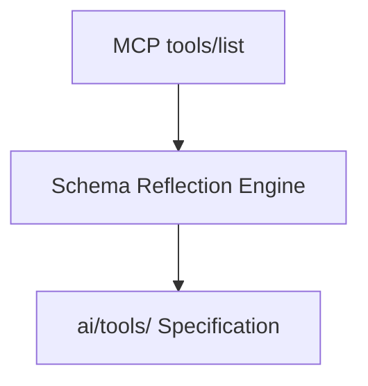

# MCP Tools Binding & Schema Reflection

## 1. Overview
Maps MCP server tools to the AI platform's internal `ai/tools/` registry.

## 2. Purpose
Exposes MCP tools seamlessly to the Planner and Executor agents.

## 3. Responsibilities
- Automatic JSON Schema reflection from MCP `tools/list` response.
- Binding parameter validators to Draft 2020-12 JSON Schemas.

## 4. Inputs
MCP Tool definitions.

## 5. Outputs
Callable Tool Contracts.

## 6. Dependencies
- [tool_contract.md](file:///c:/Users/bss/studio%20projects/chat_app/ai/sdk/tool_contract.md)

## 7. Related Files
- [registry.md](file:///c:/Users/bss/studio%20projects/chat_app/ai/mcp/registry.md)

## 8. Sequence Diagram / Workflow


## 9. Examples
```json
{
  "name": "maps_nearby_search",
  "description": "Find places near coordinates",
  "inputSchema": {
    "type": "object",
    "properties": {
      "latitude": {"type": "number"},
      "longitude": {"type": "number"}
    }
  }
}
```

## 10. Edge Cases
Dynamic schema changes update the tool contract automatically.

## 11. Error Handling
Invalid arguments return `INVALID_PARAMS` error code.

## 12. Extension Points
Filter tools by security scope.

## 13. API & Schema Versioning
MCP Tool Spec: 1.0.0

## 14. References
- MCP Spec v1.0.
