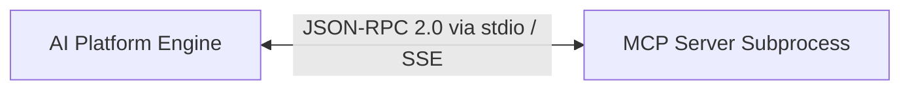

# MCP Transport Layer Specification

## 1. Overview
Defines transport layer bindings (stdio, Server-Sent Events SSE, WebSockets) for MCP communication.

## 2. Purpose
Standardizes connection lifecycle, framing, heartbeat ping/pong, and message serialization.

## 3. Responsibilities
- Transports supported: `stdio` (local subprocesses), `SSE` (remote HTTP), `WebSocket` (duplex real-time).
- JSON-RPC 2.0 message framing and request ID tracking.

## 4. Inputs
Transport URI configuration.

## 5. Outputs
JSON-RPC 2.0 frames over transport channel.

## 6. Dependencies
- [registry.md](file:///c:/Users/bss/studio%20projects/chat_app/ai/mcp/registry.md)

## 7. Related Files
- [security.md](file:///c:/Users/bss/studio%20projects/chat_app/ai/mcp/security.md)

## 8. Sequence Diagram / Workflow


## 9. Examples
```json
{
  "jsonrpc": "2.0",
  "id": 1,
  "method": "tools/call",
  "params": {
    "name": "maps_geocode",
    "arguments": {"address": "Paris, France"}
  }
}
```

## 10. Edge Cases
Socket disconnect auto-reconnects up to 3 times before fallback.

## 11. Error Handling
Returns JSON-RPC `-32603` Internal Error on transport drops.

## 12. Extension Points
Add gRPC transport adapter.

## 13. API & Schema Versioning
MCP Transport Spec: 1.0.0

## 14. References
- JSON-RPC 2.0 Specification.
