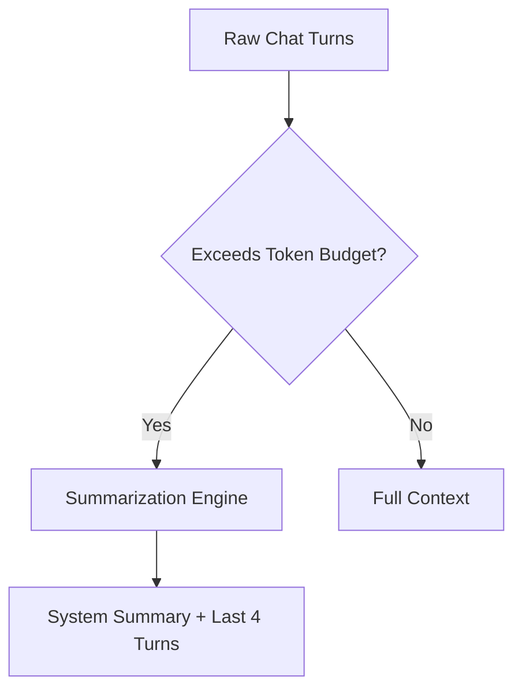

# Conversation Memory & Context Window Management

## 1. Overview
Sliding context window manager with token compaction, chat history retention, and topic summarization.

## 2. Purpose
Prevents context window overflow while preserving critical dialog history.

## 3. Responsibilities
- Track raw chat turn messages (user/assistant).
- Perform rolling summarization when token budget exceeds threshold in `ai/config/limits.md`.

## 4. Inputs
Incoming user messages & system responses.

## 5. Outputs
Compacted prompt context array.

## 6. Dependencies
- [limits.md](file:///c:/Users/bss/studio%20projects/chat_app/ai/config/limits.md)

## 7. Related Files
- [chat_message.json](file:///c:/Users/bss/studio%20projects/chat_app/ai/schemas/chat_message.json)
- [conversation.json](file:///c:/Users/bss/studio%20projects/chat_app/ai/schemas/conversation.json)

## 8. Sequence Diagram / Workflow


## 9. Examples
```json
{
  "summary": "User is searching for hotels in Paris for July 10-15 under $200/night.",
  "recent_turns": [
    {"role": "user", "content": "Any option near Louvre?"},
    {"role": "assistant", "content": "Hotel Le Relais Louvre is $180/night."}
  ]
}
```

## 10. Edge Cases
System messages are pinned and never purged during context compaction.

## 11. Error Handling
Summarization failures fall back to tail truncation (keeping last N turns).

## 12. Extension Points
Integrate local vector search over past conversation sessions.

## 13. API & Schema Versioning
Memory Spec: 2.0.0

## 14. References
- OpenAI Token Compaction Patterns.
