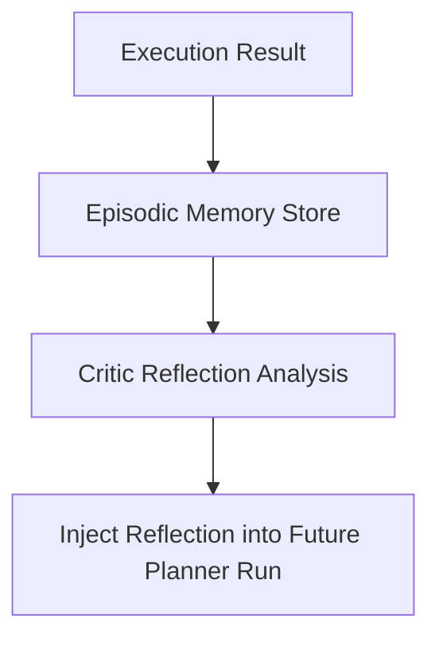

# Episodic Memory & Execution Reflection Store

## 1. Overview
Log of past multi-step task execution graphs, agent reflections, critic reviews, and step failures.

## 2. Purpose
Allows Planner and Critic agents to learn from past plan failures and avoid repeating flawed execution paths.

## 3. Responsibilities
- Record past execution DAGs and their outcome status (`SUCCESS` / `FAILED`).
- Store Critic Agent reflections for retrieval during similar goal planning.

## 4. Inputs
Task execution trace records.

## 5. Outputs
Historical execution reflections.

## 6. Dependencies
- [task.md](file:///c:/Users/bss/studio%20projects/chat_app/ai/execution/task.md)
- [critic.md](file:///c:/Users/bss/studio%20projects/chat_app/ai/agents/critic.md)

## 7. Related Files
- [planner.md](file:///c:/Users/bss/studio%20projects/chat_app/ai/agents/planner.md)
- [benchmarks.md](file:///c:/Users/bss/studio%20projects/chat_app/ai/evaluation/benchmarks.md)

## 8. Sequence Diagram / Workflow


## 9. Examples
```json
{
  "goal": "Book flight and hotel simultaneously",
  "outcome": "FAILED",
  "root_cause": "Flight API timed out; hotel booking committed without flight",
  "learned_rule": "Always verify flight availability before committing non-refundable hotel booking"
}
```

## 10. Edge Cases
Stale reflections purged after 90 days or major API version upgrades.

## 11. Error Handling
Failure to write episodic log does not block active user response flow.

## 12. Extension Points
Expose reflection graph in developer observability dashboard.

## 13. API & Schema Versioning
Memory Spec: 2.0.0

## 14. References
- Reflexion: Language Agents with Verbal Reinforcement Learning (Shinn et al.).
