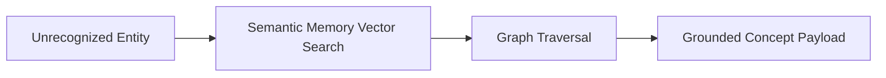

# Semantic Memory & Concept Knowledge Graph

## 1. Overview
Vector concept store indexing static domain facts, entity relationships, travel terminology, and country/city hierarchies.

## 2. Purpose
Provides semantic grounding and concept disambiguation during reasoning.

## 3. Responsibilities
- Vector embedding lookup for domain concepts.
- Relationship traversal (e.g. `Paris` -> `Capital of France` -> `Schengen Zone`).

## 4. Inputs
Query vector embedding.

## 5. Outputs
Semantic concept entities & graph triples.

## 6. Dependencies
- [countries.md](file:///c:/Users/bss/studio%20projects/chat_app/ai/knowledge/countries.md)

## 7. Related Files
- [travel.md](file:///c:/Users/bss/studio%20projects/chat_app/ai/knowledge/travel.md)
- [wikipedia.md](file:///c:/Users/bss/studio%20projects/chat_app/ai/skills/search/wikipedia.md)

## 8. Sequence Diagram / Workflow


## 9. Examples
```json
{
  "entity": "Bali",
  "category": "Island / Province",
  "country": "Indonesia",
  "primary_airport": "DPS (Ngurah Rai International)",
  "climate_zone": "Tropical"
}
```

## 10. Edge Cases
Ambiguous terms (e.g. `Paris, TX` vs `Paris, France`) return disambiguation candidates.

## 11. Error Handling
Unmatched concepts return `NEUTRAL_NO_GRAPH_MATCH`.

## 12. Extension Points
Integrate Neo4j Knowledge Graph backend.

## 13. API & Schema Versioning
Memory Spec: 2.0.0

## 14. References
- RDF / Knowledge Graph Standards.
