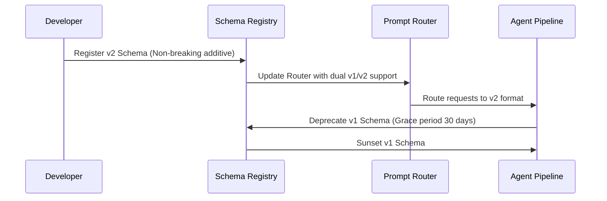

# Schema & Prompt Migration Protocol

## Overview
This document defines backward-compatibility guidelines, schema deprecation rules, and migration steps for updating AI components in production.

---

## Zero-Downtime Migration Process

---

## Breaking Change Guidelines
1. **Never delete JSON Schema fields directly**: Mark deprecated fields with `"deprecated": true` in JSON Schema.
2. **Dual-Prompt Buffering**: When upgrading system prompts, run shadow evaluation using `ai/evaluation/benchmarks.md` before deprecating legacy prompts.
3. **Tool Version Fallback**: If an external API tool version changes, update `ai/tools/<tool_name>.md` and define retry fallback in `ai/brain/recovery.md`.
