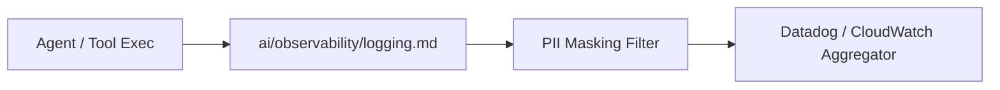

# Structured Logging Specification

## 1. Overview
Defines JSON structured logging schemas, log levels, sanitization policies, and trace correlation IDs.

## 2. Purpose
Provides observability for debugging agent execution, tool failures, and safety violations in production.

## 3. Responsibilities
- Standardize log format: `timestamp`, `level`, `agent`, `session_id`, `trace_id`, `message`, `payload`.
- Automatically redact PII using rules from `ai/brain/safety.md`.

## 4. Inputs
Agent execution events.

## 5. Outputs
Structured stdout / log aggregator stream.

## 6. Dependencies
- [safety.md](file:///c:/Users/bss/studio%20projects/chat_app/ai/brain/safety.md)

## 7. Related Files
- [metrics.md](file:///c:/Users/bss/studio%20projects/chat_app/ai/observability/metrics.md)
- [tracing.md](file:///c:/Users/bss/studio%20projects/chat_app/ai/observability/tracing.md)

## 8. Sequence Diagram / Workflow


## 9. Examples
```json
{
  "timestamp": "2026-08-04T12:00:00Z",
  "level": "INFO",
  "agent": "executor",
  "session_id": "sess_883921",
  "trace_id": "tr_99182312",
  "message": "Invoked weather_api tool",
  "duration_ms": 142
}
```

## 10. Edge Cases
Log payload truncation if JSON payload exceeds 64KB.

## 11. Error Handling
Log pipeline failure never blocks main application execution loop.

## 12. Extension Points
Integrate ELK Stack / Loki output targets.

## 13. API & Schema Versioning
Observability Spec: 1.0.0

## 14. References
- OpenTelemetry Logging Specification.
