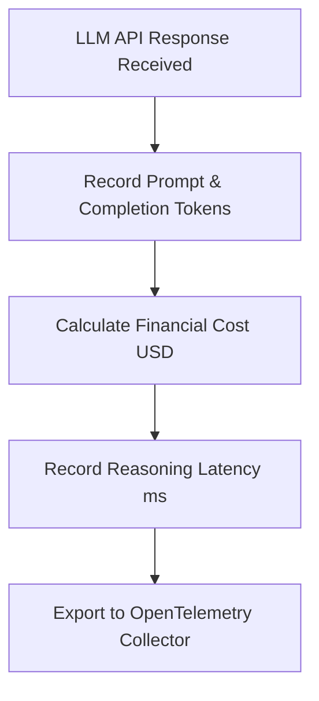

# AI Runtime Metrics & Telemetry Specification (`metrics`)

## 1. Overview
Defines telemetry metrics, token cost tracking, operational KPIs, and hallucination reporting for the Customer Support AI Runtime.

## 2. Purpose
Provides complete operational and financial visibility over LLM usage, draft acceptance rates, RAG performance, and token costs.

## 3. Responsibilities
- Collect operational counters, histograms, and financial gauges.
- Export metrics via OpenTelemetry to Prometheus / Grafana dashboards.
- Monitor CSAT and hallucination reports.

## 4. Inputs
- Execution logs, agent interaction events, LLM API response metadata.

## 5. Outputs
- Prometheus metrics endpoint and telemetry traces.

## 6. Dependencies
- `config/cost_control.md`
- `config/token_limits.md`

## 7. Related Files
- [../config/cost_control.md](../config/cost_control.md)
- [../sdk/ai_runtime_api.md](../sdk/ai_runtime_api.md)

## 8. Sequence Diagram / Workflow

## 9. Examples

### AI Runtime Telemetry Metric Matrix

| Metric Name | Type | Description | Target SLA |
| :--- | :--- | :--- | :--- |
| `ai_prompt_tokens_total` | Counter | Total prompt tokens consumed | N/A |
| `ai_completion_tokens_total` | Counter | Total completion tokens generated | N/A |
| `ai_cost_usd_total` | Counter | Cumulative financial cost in USD | < $0.05 / chat |
| `ai_draft_accepted_ratio` | Gauge | % of AI drafts accepted by human agents without edits | >= 80% |
| `ai_draft_edited_ratio` | Gauge | % of AI drafts edited before sending | <= 15% |
| `ai_auto_reply_success_ratio` | Gauge | % of autonomous replies with no escalation | >= 95% |
| `ai_escalation_rate` | Gauge | % of threads escalated to human agents | <= 20% |
| `ai_cache_hit_ratio` | Gauge | % of RAG/tool cache hits | >= 70% |
| `ai_reasoning_latency_ms` | Histogram | End-to-end reasoning pipeline latency | < 1000ms (p95) |
| `ai_hallucination_reports_total` | Counter | Flagged incorrect factual claims | 0 |

## 10. Edge Cases
- Sudden latency spike (> 3000ms): Automated alert triggers model fallback to `gemini-1.5-flash`.

## 11. Error Handling
- Metric exporter failures queue metrics locally without impacting customer responses.

## 12. Extension Points
- Dashboard templates for Grafana & Datadog.

## 13. API & Schema Versioning
- Version: 2.0.0

## 14. References
- OpenTelemetry Collector Specifications.
