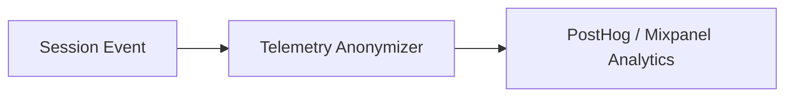

# Telemetry Aggregation & User Analytics

## 1. Overview
Defines anonymized telemetry aggregation rules for usage analytics, feature adoption, and skill execution distributions.

## 2. Purpose
Provides insight into user intent patterns without compromising privacy.

## 3. Responsibilities
- Aggregate intent category usage counts.
- Anonymize user IDs using SHA-256 salted hashes.

## 4. Inputs
System usage events.

## 5. Outputs
Anonymized telemetry stream.

## 6. Dependencies
- [safety.md](file:///c:/Users/bss/studio%20projects/chat_app/ai/brain/safety.md)

## 7. Related Files
- [metrics.md](file:///c:/Users/bss/studio%20projects/chat_app/ai/observability/metrics.md)

## 8. Sequence Diagram / Workflow


## 9. Examples
```json
{
  "event": "skill_executed",
  "skill_id": "search_events",
  "anonymized_user_hash": "a8f9b3c2...",
  "locale": "en_US"
}
```

## 10. Edge Cases
Users opting out of analytics bypass telemetry pipeline entirely.

## 11. Error Handling
Telemetry failures are swallowed silently to guarantee operational stability.

## 12. Extension Points
Integrate Mixpanel / PostHog SDKs.

## 13. API & Schema Versioning
Observability Spec: 1.0.0

## 14. References
- GDPR Telemetry Privacy Standards.
