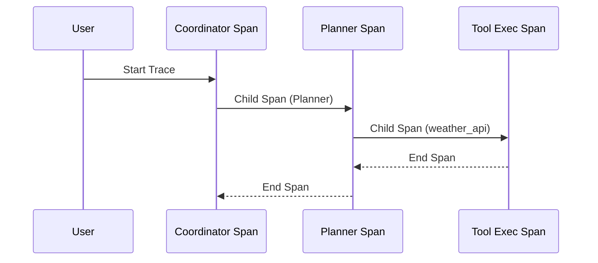

# Distributed Tracing & OpenTelemetry Spans

## 1. Overview
Defines OpenTelemetry span trees for multi-agent ReAct iterations and tool invocations.

## 2. Purpose
Provides end-to-end visibility into request execution paths across agents, MCP servers, and external REST APIs.

## 3. Responsibilities
- Propagate `traceparent` W3C headers across agent layers.
- Create spans for Coordinator -> Planner -> Executor -> Verifier pipeline.

## 4. Inputs
Incoming request headers.

## 5. Outputs
OpenTelemetry Trace Spans.

## 6. Dependencies
- [agent_contract.md](file:///c:/Users/bss/studio%20projects/chat_app/ai/sdk/agent_contract.md)

## 7. Related Files
- [logging.md](file:///c:/Users/bss/studio%20projects/chat_app/ai/observability/logging.md)

## 8. Sequence Diagram / Workflow


## 9. Examples
```json
{
  "trace_id": "4bf92f3577b34da6a3ce929d0e0e4736",
  "span_id": "00f067aa0ba902b7",
  "name": "Executor:weather_api",
  "kind": "CLIENT",
  "attributes": {
    "rpc.system": "mcp",
    "rpc.method": "tools/call"
  }
}
```

## 10. Edge Cases
Orphaned spans closed automatically on task cancellation.

## 11. Error Handling
Spans record exception event details upon step error.

## 12. Extension Points
Export to Jaeger / Zipkin tracing backends.

## 13. API & Schema Versioning
Observability Spec: 1.0.0

## 14. References
- W3C Trace Context Recommendation.
