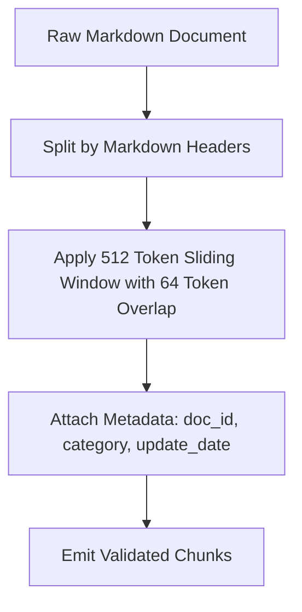

# RAG Document Chunking Strategy (`chunking`)

## 1. Overview
Defines chunking strategies for splitting knowledge base documents (FAQs, shipping policies, product catalogs) into optimal text segments for embedding and vector search.

## 2. Purpose
Ensures knowledge chunks preserve semantic context while remaining within vector embedding model token windows.

## 3. Responsibilities
- Execute semantic Markdown header-aware chunking (`#`, `##`, `###`).
- Enforce token size bounds (Target: 512 tokens, Overlap: 64 tokens).
- Attach metadata tags to every chunk (`doc_id`, `category`, `last_updated`).

## 4. Inputs
- Raw Markdown documents from `ai/knowledge/`.

## 5. Outputs
- Array of chunk objects with text snippets and metadata headers.

## 6. Dependencies
- `knowledge/`
- `rag/embeddings.md`

## 7. Related Files
- [embeddings.md](embeddings.md)
- [vector_store.md](vector_store.md)
- [../knowledge/faq.md](../knowledge/faq.md)

## 8. Sequence Diagram / Workflow



## 9. Examples

### Chunk Metadata Structure
```json
{
  "chunk_id": "chk_9012",
  "doc_id": "refund_policy",
  "category": "legal",
  "content": "Items can be returned within 30 days of receipt for a full refund...",
  "token_count": 142
}
```

## 10. Edge Cases
- Short documents (< 512 tokens): Retained as a single chunk without window splitting.

## 11. Error Handling
- Unparseable markup falls back to character-length sliding window chunking.

## 12. Extension Points
- Table-aware chunking for product pricing matrices.

## 13. API & Schema Versioning
- Version: 2.0.0

## 14. References
- Semantic Chunking Best Practices.
