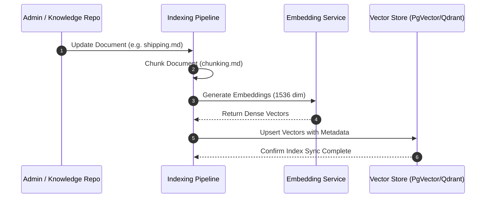

# Knowledge Indexing & Ingestion Pipeline (`indexing`)

## 1. Overview
Defines batch and real-time ingestion pipelines for syncing knowledge base updates to the vector store.

## 2. Purpose
Keeps the vector database up to date whenever FAQ articles, policies, or product catalogs are added or modified.

## 3. Responsibilities
- Monitor `ai/knowledge/` directory for file modification events.
- Run chunking, embedding, and vector upsert operations.
- Remove obsolete vectors when documents are deleted.

## 4. Inputs
- Document updates in `ai/knowledge/`.

## 5. Outputs
- Vector store index status updates.

## 6. Dependencies
- `rag/chunking.md`
- `rag/embeddings.md`
- `rag/vector_store.md`

## 7. Related Files
- [vector_store.md](vector_store.md)
- [../knowledge/faq.md](../knowledge/faq.md)

## 8. Sequence Diagram / Workflow



## 9. Examples

### Ingestion Metric
```json
{
  "doc_id": "shipping_policy",
  "chunks_created": 12,
  "vectors_upserted": 12,
  "duration_ms": 340,
  "status": "synced"
}
```

## 10. Edge Cases
- Partial index failure: Re-indexing uses idempotent upsert key `doc_id#chunk_index`.

## 11. Error Handling
- Failed indexing jobs raise `RAG_INDEXING_FAILED` alert.

## 12. Extension Points
- Automated CMS webhook integration for real-time web knowledge syncing.

## 13. API & Schema Versioning
- Version: 2.0.0

## 14. References
- Vector Indexing Standards.
