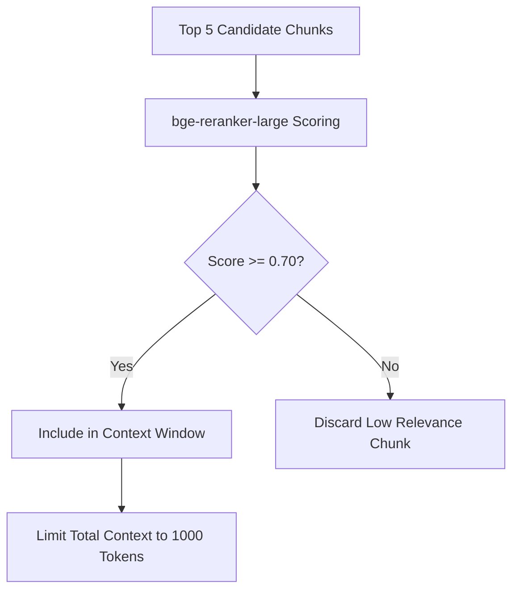

# Cross-Encoder Re-Ranking & Relevance Thresholding (`ranking`)

## 1. Overview
Defines cross-encoder re-ranking rules for filtering and re-ordering candidate RAG chunks.

## 2. Purpose
Eliminates false positives and selects only high-relevance chunks for injection into LLM context prompts.

## 3. Responsibilities
- Score candidate query-chunk pairs using a Cross-Encoder model (`bge-reranker-large`).
- Filter out chunks below minimum relevance threshold (`0.70`).
- Truncate total context to max 1000 tokens.

## 4. Inputs
- Top-5 candidate chunks from `rag/retrieval.md`.

## 5. Outputs
- Re-ranked array of top 1–3 verified relevant context chunks.

## 6. Dependencies
- `rag/retrieval.md`
- `shared/constants.md`

## 7. Related Files
- [retrieval.md](retrieval.md)
- [../brain/reasoning_pipeline.md](../brain/reasoning_pipeline.md)

## 8. Sequence Diagram / Workflow



## 9. Examples

### Re-Ranked Output Payload
```json
{
  "total_candidate_chunks": 5,
  "re_ranked_chunks": 2,
  "top_chunk_score": 0.94,
  "injected_context_tokens": 310
}
```

## 10. Edge Cases
- All chunks score below 0.70: RAG module signals "no relevant knowledge found", preventing hallucination.

## 11. Error Handling
- Re-ranker failure falls back to raw vector similarity scores.

## 12. Extension Points
- Fine-tuned domain re-rankers.

## 13. API & Schema Versioning
- Version: 2.0.0

## 14. References
- Cross-Encoder Re-Ranking Specifications.
