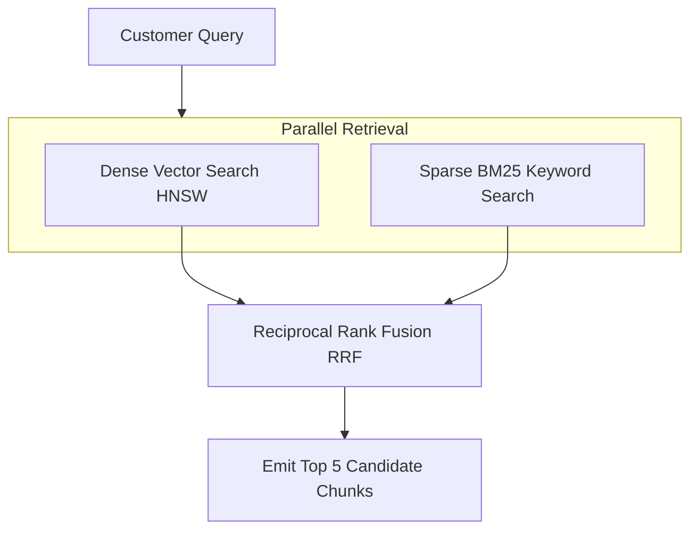

# Hybrid Search & Context Retrieval (`retrieval`)

## 1. Overview
Defines hybrid retrieval logic combining dense vector semantic search with BM25 full-text keyword search.

## 2. Purpose
Ensures accurate retrieval for both conceptual semantic queries ("How do I get my money back?") and exact keyword searches ("Order #58210").

## 3. Responsibilities
- Execute parallel dense vector search and sparse BM25 keyword search.
- Merge result sets using Reciprocal Rank Fusion (RRF).
- Return Top-5 candidate chunks.

## 4. Inputs
- Customer query string and optional category filter.

## 5. Outputs
- Ordered list of relevant text chunks with similarity scores.

## 6. Dependencies
- `rag/vector_store.md`
- `rag/ranking.md`

## 7. Related Files
- [ranking.md](ranking.md)
- [vector_store.md](vector_store.md)
- [../brain/reasoning_pipeline.md](../brain/reasoning_pipeline.md)

## 8. Sequence Diagram / Workflow



## 9. Examples

### Retrieval Output
```json
{
  "query": "How do I return an item?",
  "chunks": [
    { "chunk_id": "chk_9012", "score": 0.89, "text": "Items can be returned within 30 days..." }
  ]
}
```

## 10. Edge Cases
- Query containing exact product SKU: Sparse search weight boosted to 0.8.

## 11. Error Handling
- Search service timeout falls back to sparse keyword search only.

## 12. Extension Points
- User intent-weighted search blending.

## 13. API & Schema Versioning
- Version: 2.0.0

## 14. References
- Reciprocal Rank Fusion Paper (Cormack et al.).
