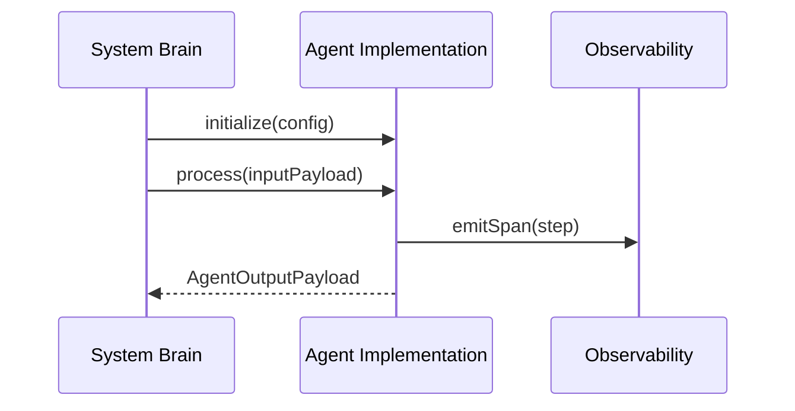

# AI Agent SDK Interface Contract

## 1. Overview
Defines the base object interface, lifecycle hooks, and async event channels that every Agent in `ai/agents/` must implement.

## 2. Purpose
Provides a strict programming foundation so agents can be orchestrated interchangeably by the System Brain and Executor engine.

## 3. Responsibilities
- Declare mandatory methods: `initialize()`, `process()`, `validate()`, `shutdown()`.
- Standardize execution context passing and telemetry reporting.

## 4. Inputs
`AgentInputPayload` containing session ID, user context, and current execution state.

## 5. Outputs
`AgentOutputPayload` containing status, data artifacts, confidence scores, and next action dispatches.

## 6. Dependencies
- [constants.md](file:///c:/Users/bss/studio%20projects/chat_app/ai/shared/constants.md)
- [error_codes.md](file:///c:/Users/bss/studio%20projects/chat_app/ai/shared/error_codes.md)

## 7. Related Files
- [coordinator.md](file:///c:/Users/bss/studio%20projects/chat_app/ai/agents/coordinator.md)
- [planner.md](file:///c:/Users/bss/studio%20projects/chat_app/ai/agents/planner.md)
- [executor.md](file:///c:/Users/bss/studio%20projects/chat_app/ai/agents/executor.md)

## 8. Sequence Diagram / Workflow


## 9. Examples
```typescript
interface AgentContract {
  agentId: string;
  role: string;
  initialize(config: AgentConfig): Promise<void>;
  process(input: AgentInputPayload): Promise<AgentOutputPayload>;
  validateOutput(output: AgentOutputPayload): boolean;
}
```

## 10. Edge Cases
Unhandled exceptions inside `process()` are wrapped in `REASONING_ERR_AGENT_CRASH`.

## 11. Error Handling
Agents must throw standardized `AgentException` with error codes from `ai/shared/error_codes.md`.

## 12. Extension Points
Subclass `BaseAgent` to create custom domain agents.

## 13. API & Schema Versioning
SDK Contract Version: 2.0.0

## 14. References
- [DOCUMENTATION_GUIDELINES.md](file:///c:/Users/bss/studio%20projects/chat_app/ai/DOCUMENTATION_GUIDELINES.md)
