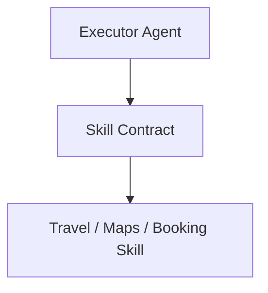

# Skill SDK Interface Contract

## 1. Overview
Defines the base interface for domain capabilities defined under `ai/skills/`.

## 2. Purpose
Decouples domain skill logic from agent reasoning engines.

## 3. Responsibilities
- Declare mandatory methods: `getMetadata()`, `canHandle()`, `execute()`.
- Expose trigger condition matchers.

## 4. Inputs
Skill execution input parameters.

## 5. Outputs
Typed skill execution result.

## 6. Dependencies
- [agent_contract.md](file:///c:/Users/bss/studio%20projects/chat_app/ai/sdk/agent_contract.md)

## 7. Related Files
- [search_events.md](file:///c:/Users/bss/studio%20projects/chat_app/ai/skills/travel/search_events.md)
- [routing.md](file:///c:/Users/bss/studio%20projects/chat_app/ai/brain/routing.md)

## 8. Sequence Diagram / Workflow


## 9. Examples
```typescript
interface SkillContract<TInput, TOutput> {
  skillId: string;
  category: string;
  canHandle(intent: string): boolean;
  execute(input: TInput): Promise<TOutput>;
}
```

## 10. Edge Cases
Missing parameters fail validation before `execute()` is called.

## 11. Error Handling
Returns `SkillException` with error details.

## 12. Extension Points
Implement custom skill handlers in Flutter or backend service.

## 13. API & Schema Versioning
SDK Contract Version: 2.0.0

## 14. References
- [DOCUMENTATION_GUIDELINES.md](file:///c:/Users/bss/studio%20projects/chat_app/ai/DOCUMENTATION_GUIDELINES.md)
