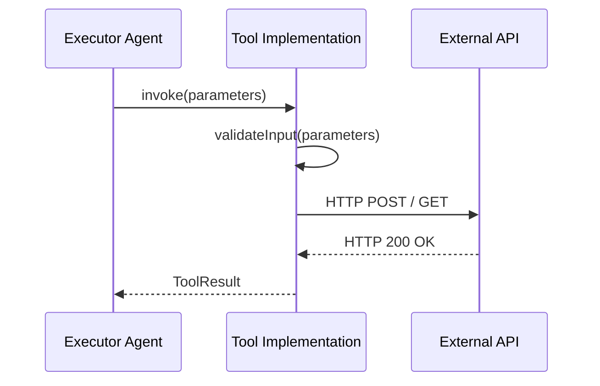

# Tool SDK Interface Contract

## 1. Overview
Defines the executable wrapper contract for REST APIs, MCP tools, and native SDK methods defined in `ai/tools/`.

## 2. Purpose
Standardizes parameter validation, timeout management, rate limiting, and output parsing across all external tools.

## 3. Responsibilities
- Declare mandatory methods: `invoke()`, `validateInput()`, `getSchema()`.
- Enforce timeout and retry policies.

## 4. Inputs
Tool parameter map matching JSON Schema in `ai/schemas/`.

## 5. Outputs
Standardized `ToolResult` payload.

## 6. Dependencies
- [error_codes.md](file:///c:/Users/bss/studio%20projects/chat_app/ai/shared/error_codes.md)

## 7. Related Files
- [events_api.md](file:///c:/Users/bss/studio%20projects/chat_app/ai/tools/events_api.md)
- [tool_call.json](file:///c:/Users/bss/studio%20projects/chat_app/ai/schemas/tool_call.json)

## 8. Sequence Diagram / Workflow


## 9. Examples
```typescript
interface ToolContract {
  name: string;
  version: string;
  timeoutMs: number;
  invoke(params: Record<string, any>): Promise<ToolResult>;
}
```

## 10. Edge Cases
Network timeouts auto-wrap into `TOOL_ERR_TIMEOUT`.

## 11. Error Handling
Catches HTTP non-2xx status codes and formats `api_error.json`.

## 12. Extension Points
Wrap REST endpoints, gRPC services, or MCP endpoints.

## 13. API & Schema Versioning
SDK Contract Version: 2.0.0

## 14. References
- OpenAPI 3.0 Specification.
