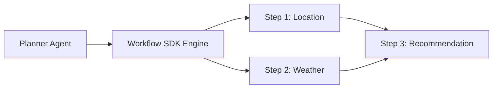

# Workflow Execution Engine SDK Contract

## 1. Overview
Defines the engine interface for orchestrating multi-agent DAG workflows defined in `ai/workflows/`.

## 2. Purpose
Provides execution state transitions, step parallelism, and compensation rollbacks.

## 3. Responsibilities
- Methods: `compileDAG()`, `executeWorkflow()`, `cancelWorkflow()`.
- Parallel execution of non-dependent steps.

## 4. Inputs
`WorkflowDefinition` DAG.

## 5. Outputs
`WorkflowResult` artifact.

## 6. Dependencies
- [agent_contract.md](file:///c:/Users/bss/studio%20projects/chat_app/ai/sdk/agent_contract.md)
- [tool_contract.md](file:///c:/Users/bss/studio%20projects/chat_app/ai/sdk/tool_contract.md)

## 7. Related Files
- [plan_trip.md](file:///c:/Users/bss/studio%20projects/chat_app/ai/workflows/plan_trip.md)

## 8. Sequence Diagram / Workflow


## 9. Examples
```typescript
interface WorkflowEngineContract {
  executeDAG(dag: ExecutionDAG): Promise<WorkflowExecutionResult>;
}
```

## 10. Edge Cases
Step failure triggers compensation steps if defined.

## 11. Error Handling
Returns `WORKFLOW_ERR_STEP_FAILED` with partial results.

## 12. Extension Points
Add visual workflow debugger hook.

## 13. API & Schema Versioning
SDK Contract Version: 2.0.0

## 14. References
- [DOCUMENTATION_GUIDELINES.md](file:///c:/Users/bss/studio%20projects/chat_app/ai/DOCUMENTATION_GUIDELINES.md)
