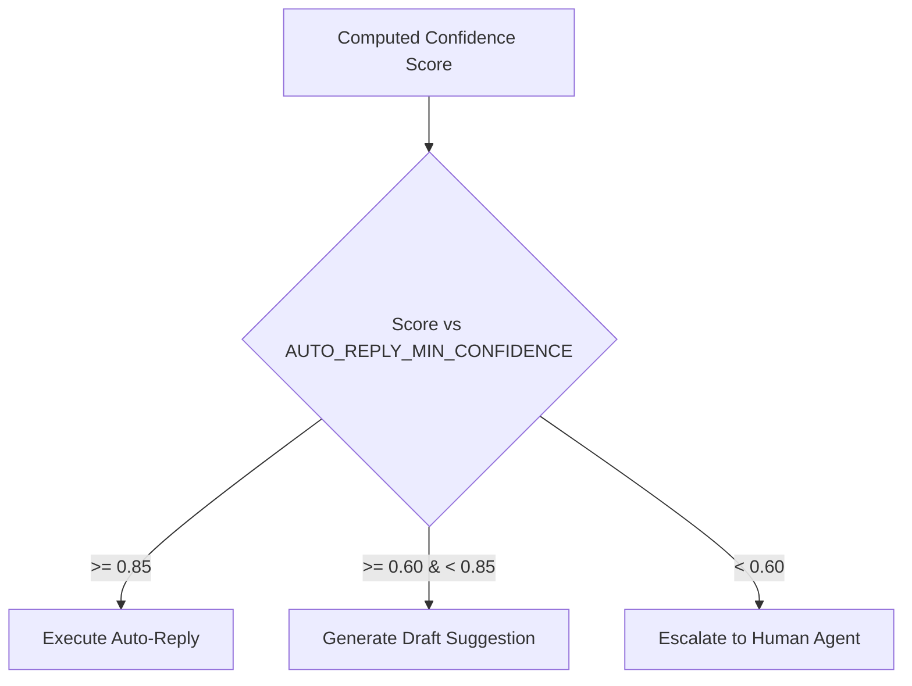

# Shared System Constants

## 1. Overview
Central reference document for all system-wide numerical thresholds, timeouts, confidence cutoffs, and default values used across the Customer Support AI Microservice.

## 2. Purpose
Provides a single source of truth for runtime constants to ensure consistent decision-making between agents, brain modules, and API tools.

## 3. Responsibilities
- Define confidence thresholds for auto-reply vs. draft suggestion vs. escalation.
- Define request timeouts and retry limits for backend API calls.
- Define memory buffer caps and max token allocations.

## 4. Inputs
None (Static specification).

## 5. Outputs
Constants referenced by `ai/brain/decision_engine.md`, `ai/brain/confidence.md`, and `ai/tools/`.

## 6. Dependencies
None.

## 7. Related Files
- [error_codes.md](error_codes.md)
- [glossary.md](glossary.md)
- [../brain/confidence.md](../brain/confidence.md)
- [../brain/decision_engine.md](../brain/decision_engine.md)

## 8. Sequence Diagram / Workflow



## 9. Examples

### System Threshold Constants
```json
{
  "AUTO_REPLY_MIN_CONFIDENCE": 0.85,
  "DRAFT_SUGGESTION_MIN_CONFIDENCE": 0.60,
  "ESCALATION_CONFIDENCE_THRESHOLD": 0.60,
  "MAX_SESSION_MEMORY_MESSAGES": 30,
  "MAX_THREAD_SUMMARY_TOKENS": 250,
  "API_TIMEOUT_MS": 5000,
  "API_MAX_RETRIES": 3
}
```

## 10. Edge Cases
- If confidence score is exactly 0.85, system defaults to Auto-Reply.
- If confidence score is exactly 0.60, system defaults to Draft Suggestion.

## 11. Error Handling
- Missing constant lookup throws a `CONFIG_MISSING_CONSTANT` error (see [error_codes.md](error_codes.md)).

## 12. Extension Points
- Thresholds can be overridden via `ai/config/features.md` on a per-channel or per-company basis.

## 13. API & Schema Versioning
- Version: 2.0.0

## 14. References
- RFC 2119 Key Words for Requirements.
