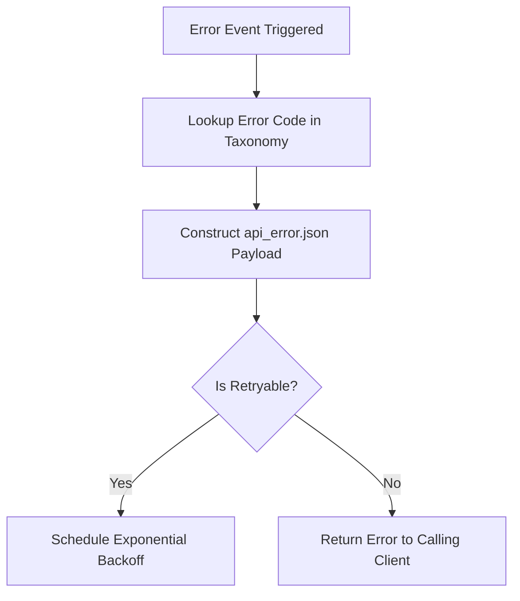

# Shared Error Codes & Taxonomy

## 1. Overview
Standardized error codes, HTTP status mappings, and retry strategies for all error conditions in the Customer Support AI Microservice.

## 2. Purpose
Ensures uniform error reporting across Laravel API proxies, mobile app state handlers, and AI agent execution failures.

## 3. Responsibilities
- Maintain error code taxonomy across Authentication, Validation, API, Reasoning, and System categories.
- Define HTTP status codes and retry eligibility for every error type.

## 4. Inputs
System exception events.

## 5. Outputs
Standardized error responses conforming to [api_error.json](../schemas/api_error.json).

## 6. Dependencies
- [constants.md](constants.md)
- [../schemas/api_error.json](../schemas/api_error.json)

## 7. Related Files
- [constants.md](constants.md)
- [../schemas/api_error.json](../schemas/api_error.json)
- [../brain/recovery.md](../brain/recovery.md)

## 8. Sequence Diagram / Workflow

## 9. Examples

### Error Taxonomy Table

| Error Code | Category | HTTP Status | Retryable | Description |
| :--- | :--- | :--- | :--- | :--- |
| `AUTH_INVALID_TOKEN` | AUTH_ERR | 401 | No | Bearer token expired or invalid |
| `VAL_INVALID_PAYLOAD` | VALIDATION_ERR | 400 | No | Inbound payload failed JSON schema validation |
| `CHAT_NOT_FOUND` | DATA_ERR | 404 | No | Requested chatId does not exist |
| `API_TIMEOUT_EXCEEDED` | TOOL_ERR | 504 | Yes | Backend API timed out (> 5000ms) |
| `LLM_RATE_LIMITED` | MODEL_ERR | 429 | Yes | AI inference microservice rate limited |
| `CONFIDENCE_TOO_LOW` | REASONING_ERR | 422 | No | Intent confidence below minimum threshold |
| `ESCALATION_TRIGGERED` | WORKFLOW_ERR | 200 | No | Human escalation triggered; AI stepping down |

## 10. Edge Cases
- Unknown errors default to `SYSTEM_UNHANDLED_EXCEPTION` (500, non-retryable).

## 11. Error Handling
- Retryable errors enforce backoff intervals defined in [constants.md](constants.md).

## 12. Extension Points
- New domain-specific error codes can be added under custom error prefixes.

## 13. API & Schema Versioning
- Version: 2.0.0

## 14. References
- RFC 7807 Problem Details for HTTP APIs.
