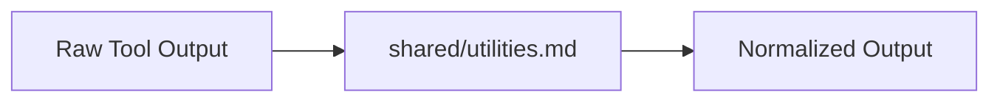

# Shared Utility Functions & Contracts

## 1. Overview
Shared data transformations, string sanitizers, token estimators, and date formatters.

## 2. Purpose
Common helper contracts for agents, prompt interpolators, and tool parameter converters.

## 3. Responsibilities
- Token counting estimation algorithms.
- Geo-coordinate format conversion (DMS to Decimal Degrees).
- ISO 8601 UTC date string generation.

## 4. Inputs
Raw parameters.

## 5. Outputs
Normalized parameters.

## 6. Dependencies
- [constants.md](file:///c:/Users/bss/studio%20projects/chat_app/ai/shared/constants.md)

## 7. Related Files
- [conventions.md](file:///c:/Users/bss/studio%20projects/chat_app/ai/shared/conventions.md)

## 8. Sequence Diagram / Workflow


## 9. Examples
```typescript
function formatIsoDate(date: Date): string {
  return date.toISOString();
}
```

## 10. Edge Cases
Null inputs safely return empty string or null default value.

## 11. Error Handling
Invalid format attempts log a warning and return default constant value.

## 12. Extension Points
Add Flutter Dart utility contracts.

## 13. API & Schema Versioning
Version: 1.0.0

## 14. References
- ISO 8601 Standard.
